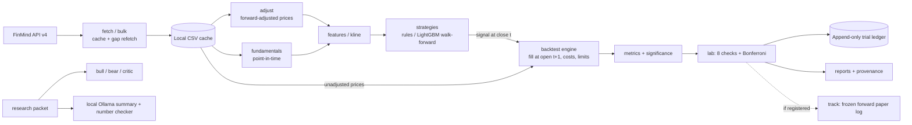

# TW Stock Research & Backtest Lab / 台股研究與回測實驗室

**EN** — A research and simulation toolkit for Taiwan equities: a backtest engine that models real TWSE/TPEx trading rules, a leakage-hardened data pipeline, a pre-registered strategy lab that is designed to reject overfit ideas, forward paper-tracking, and a local-only LLM reporting layer.

**中文** — 台股研究與模擬工具：還原台股真實交易規則的回測引擎、防未來資料外洩的資料管線、以「事前登記」擋下過度擬合的策略實驗室、前瞻紙上追蹤，以及只連本機的 LLM 報告層。

> **Disclaimer / 免責聲明**
> **EN:** Research & simulation only. By design there is **no order execution, no broker API, no account connection, and no auto-trading**. Nothing here is investment advice.
> **中文：** 僅供研究與模擬。設計上**沒有下單、券商 API、帳戶連線或自動交易功能**，輸出內容不構成投資建議。

---

## Research summary / 研究摘要

📄 **Working paper: [Do Simple Stock-Selection Rules Beat a Passive Benchmark in Taiwan After Realistic Frictions?](docs/paper.md)**

**EN** — Research question: after realistic Taiwan-market frictions, does a simple, pre-registered stock-selection rule beat the dividend-inclusive 0050 ETF on a risk-adjusted basis by more than luck? Four rules (momentum + quality, revenue acceleration, value + growth, and an AI-proposed illiquidity premium) were tested on the full market including delisted stocks (2017-07 to 2024-12) against 0050 and a **turnover-matched random-selection control**, with six robustness checks and a Bonferroni correction. **All four failed.** The best development-period rule (28.2% CAGR) had a lower Sharpe than 0050 and returned 12.3% a year in the 2025–26 holdout versus 54.1% for 0050. Key methodological finding: the same rule had p = 0.010 against naive random portfolios but p = 0.143 against turnover-matched ones. **The choice of control decides the conclusion.**

**中文** — 研究問題：扣除台股真實交易摩擦後，事前登記的簡單選股規則，風險調整後報酬能否以超過運氣的幅度勝過 0050 含息？在全市場（含已下市，2017-07 ~ 2024-12）檢驗四個規則：動能加品質、營收加速、價值加成長、AI 提出的低流動性溢酬。對照組是 0050 與**配對換手率的隨機選股**，另有六項穩健性檢驗與 Bonferroni 修正。**四個全部不通過。** 開發期最好的規則（年化 28.2%）Sharpe 仍低於 0050，保留期年化 12.3%，同期 0050 為 54.1%。方法論上最重要的發現：同一規則對單純隨機組 p = 0.010，對配對換手率的隨機組 p = 0.143，**對照組的設計會決定結論**。

---

## 1. Highlights / 亮點

### 1.1 Realistic Taiwan-market backtest engine / 貼近台股真實規則的回測引擎
- **EN:** Signal on close of day *t*, fill at the **open of *t+1*** (never the same close that produced the signal). Commission 0.1425% x discount, floored to whole TWD with a 20 TWD minimum; 0.3% securities transaction tax on sells. Limit-up/limit-down: a buy at a limit-up open or a sell at a limit-down open is skipped and logged. Board lots (1,000 shares) or odd lots. Liquidity cap: shares bought <= average volume of the N days *before* the fill day x participation rate (the fill day's own volume is never used). Dividends credited on ex-date; corporate actions (capital reduction, splits, par-value changes) taken from official data rather than inferred from price gaps.
- **中文：** t 日收盤產生訊號、t+1 日開盤成交。手續費 0.1425% x 折扣、無條件捨去、最低 20 元；賣出證交稅 0.3%。開盤漲停買不到、開盤跌停賣不掉，跳過並記錄。支援整張 / 零股。流動性上限：買進股數不超過成交日「之前」N 日均量 x 參與率（不用當日量）。除權息入帳；減資、分割、面額變更一律使用官方資料，不用價差推算。

### 1.2 Look-ahead leakage defenses / 防未來資料外洩
- **EN:** Forward-only price adjustment (used for signals/features only; fills, limits and costs use unadjusted prices). Fundamentals are aligned point-in-time to statutory disclosure deadlines (monthly revenue by the 10th of the next month; quarterly reports by quarter-end + 45 days, financials + 2 months, annual by Mar 31; plus a one-day buffer). A **truncation-invariance test** shows that features at row *t* do not change when future data is cut off. LightGBM runs walk-forward with `gap >= horizon` between train and test. **Oracle tests** must all pass: a cheating model that peeks at tomorrow's return must exceed 100% annualized; three deliberately broken variants (fill at same-day close, forgot transaction tax, features shifted one day into the future) must each be caught; hand-computed trade costs must match the engine exactly; random signals must clearly underperform buy-and-hold after costs.
- **中文：** 向前還原價只給訊號 / 特徵，成交與漲跌停用未還原價。基本面依法定公告期限做時間點對齊（月營收次月 10 日；季報季末 + 45 天、金融業 + 2 個月、年報 3/31；再加 1 天緩衝）。「特徵截斷不變性」測試確認第 t 列不受未來資料影響。LightGBM 採 walk-forward，訓練與測試間留 `gap >= horizon`。Oracle 測試必須全過：偷看明日報酬的作弊模型年化須 > 100%；三個故意埋錯的版本（當天收盤成交、忘記證交稅、特徵往未來偏移一天）都必須被擋下；手算成本與引擎一致；隨機訊號扣成本後明顯輸給買進持有。

### 1.3 Strategy Lab: a machine for rejecting ideas / 策略實驗室：專門用來淘汰想法
- **EN:** A strategy is a pre-registered YAML file (hypothesis, rationale, failure condition, universe, parameters). It is evaluated **only on the development period** with eight fixed checks, all of which must pass:
  1. beats dividend-inclusive 0050 (higher Sharpe, drawdown not more than 10 pts worse)
  2. beats matched random selection (same pool, same number of names, same turnover) at the top 5% on both CAGR and Sharpe
  3. neighboring parameters (+/-20%) mostly still beat 0050
  4. both halves of the sample beat 0050
  5. still beats 0050 at 2x costs
  6. still beats 0050 if delisted holdings go to zero
  7. still beats 0050 after dropping the top 3 contributing stocks
  8. still beats 0050 after removing the best calendar year

  Multiple testing is handled with a **Bonferroni** correction over every distinct rule ever tried. An **append-only trial ledger** (`trials.csv`) records each run, so "keep trying until something works" is visible and counted. The rule hash includes the config parameters that affect results; editing a registered rule means a new file and a new count. A small-account scenario (odd lots, small capital) is also reported. Thresholds live in code and docs and cannot be edited per strategy.
- **中文：** 策略是事前登記的 YAML（假設、理由、失效條件、股票池、參數），只用開發期做 8 項固定檢驗，全部通過才算：對 0050 含息、配對隨機選股（同池同檔數同換手）前 5%、鄰近參數 ±20%、前後兩段、兩倍成本、下市持股歸零、拿掉貢獻前 3 檔、拿掉最好一年。多重比較用 Bonferroni（乘以至今試過的不同規則數）。試驗帳本只追加、不刪改，讓「試到成功為止」無處可藏；規則雜湊包含會影響結果的 config 參數，改規則就是新規則。另有小額帳戶情境。門檻寫死在程式與文件，策略檔不能改。

### 1.4 Data integrity / 資料完整性
- **EN:** Full-market universe **including delisted stocks** to reduce survivorship bias; an integrity audit (delistings, suspensions, candidate coverage); **point-in-time vintage snapshots** that append newly seen or revised fundamentals with a first-seen date (append-only); reports embed provenance (config hash, data snapshot hash, git commit, package versions).
- **中文：** 全市場含已下市股票以降低存活者偏差；資料完整性盤點（下市、停牌、候選名單涵蓋）；基本面「版本快照」只追加新出現或被更正的列並記下首次看到日期；每份報告附重現資訊（設定雜湊、資料快照雜湊、git commit、套件版本）。

### 1.5 Forward paper-tracking / 前瞻模擬追蹤
- **EN:** Because the holdout period has been consumed, genuine out-of-sample evidence can only come from data that arrives after registration. Tracked rules are **frozen by hash**, logs are **append-only**, and a signal recorded late is filled at the next open after the record date; the past is never back-filled. Each day is compared against dividend-inclusive 0050 and matched random baselines (fixed seeds). Paper trading only.
- **中文：** 保留期已被消耗，真正的樣本外證據只能來自登記之後才發生的資料。追蹤中的規則以雜湊鎖定、紀錄只追加；晚記錄的訊號在記錄日之後第一個開盤成交，不回補已過去的開盤。每日對照 0050 含息與配對隨機組（固定 seed）。純紙上模擬。

### 1.6 LLM / agent layer / LLM 與 agent
- **EN:** A multi-agent **bull / bear / critic** debate over a program-generated research packet (bull and bear cite numbers from the packet; the critic fact-checks both and lists open questions; no verdict, no buy/sell advice). A **local** Ollama model (Qwen3 4B) writes plain-language summaries; a **number checker** compares every figure in the output with the input, and a banned-word list blocks advice-like phrasing. The LLM client only accepts localhost endpoints. AI may also *propose* research hypotheses (with a literature source and a "who pays" rationale), but under a **monthly quota** and a **graveyard rule**: once an AI rule in a family fails, no new rule in that family may be proposed (no re-tuning the same idea). AI-proposed rules face the same thresholds and the same Bonferroni count, and run only after human approval.
- **中文：** 多方 / 空方 / 查核員三方辯論，輸入是程式產生的研究資料包，雙方引用數字，查核員逐點核對並列出爭點，不判定勝負、不給買賣建議。本機 Ollama（Qwen3 4B）寫白話摘要；**數字查核器**逐一比對輸出與輸入的數字，**禁用詞**擋掉建議式用語；LLM 只允許連本機。AI 也能提出有文獻依據的研究假設（須寫明誰在賠錢、來源），但受**每月額度**與**墓園規則**限制：同家族已有 AI 規則不通過，就不能再提同家族新規則。AI 規則與使用者規則適用同一門檻與同一 Bonferroni 計數，且須人工同意才執行。

### 1.7 Engineering workflow / 工程流程
- **EN:** 250 pytest tests including oracle tests and a `mutants.py` of intentionally buggy variants. Development uses Claude Code with role-specific sub-agents (explorer, fixer, checker, leak-reviewer, diff-reviewer). A **git pre-commit gate** hashes the staged diff, requires a reviewer approval for exactly that hash, and blocks the commit if the content differs.
- **中文：** 250 個 pytest 測試，含 oracle 測試與故意埋錯的 `mutants.py`。以 Claude Code 子代理分工（explorer、fixer、checker、leak-reviewer、diff-reviewer）。git pre-commit 閘門會雜湊暫存差異，須經審查核准該雜湊才能提交，內容不符就擋下。

---

## 2. Key findings / 主要結果（誠實呈現失敗）

**EN:** Every rule tested so far **failed**. That is the tool doing its job: stopping overfit ideas before they look like discoveries. Results below are development period only (2017-07 to 2024-12). The 2025+ holdout was consumed by an earlier ranking rule (since retired), so future out-of-sample evidence can only come from forward tracking.

**中文：** 至今試過的規則**全部沒有通過**，這正是工具該做的事：在過度擬合的想法看起來像發現之前擋下它。下表僅為開發期（2017-07 ~ 2024-12）；2025 年起的保留期已被先前（已淘汰）的排名規則消耗，往後的樣本外證據只能來自前瞻追蹤。

| Strategy / 策略 | Idea / 想法 | CAGR 年化 | Sharpe | Max DD 最大回撤 | Verdict / 判定 |
|---|---|---|---|---|---|
| **0050 (div-incl.) / 0050 含息** | Benchmark / 基準 | 14.9% | 0.91 | -30.2% | baseline |
| retired_rank | Momentum + revenue growth + positive earnings, top 10 / 動能 + 營收成長 + 獲利，取 10 檔 | 28.2% | 0.85 | -52.9% | Fail 不通過 (random-selection Sharpe p = 0.143; 2x-cost Sharpe 0.79 < 0.91) |
| global_trend_momentum | Strong price + accelerating revenue, top 5 / 股價強 + 營收加速，取 5 檔 | 18.0% | 0.60 | -67.6% | Fail 不通過 (neighbor params 0/8 beat 0050) |
| cheap_growth | Low P/E + revenue growth, top 5 / 低本益比 + 營收成長，取 5 檔 | -0.7% | 0.09 | -50.1% | Fail 不通過 (Sharpe p = 0.960, worse than random median) |
| ai_illiquidity_quality | AI-proposed: illiquidity premium among profitable firms (Amihud 2002 and related) / AI 提出：有獲利公司中的低流動性溢酬 | 19.0% | 0.95 | -41.3% | Fail 不通過 (Sharpe above 0050 but drawdown 11 pts deeper; random p = 0.089 × 4 rules = 0.36; with NT$20k capital and NT$20 min fee: CAGR 13.6%) |

**Takeaways / 觀察**
- **EN:** The retired ranking rule looked attractive (28.2% CAGR) but its Sharpe was below 0050's, its drawdown was about 23 pts deeper, and it did not clear the random-selection test. Raw CAGR alone would have been misleading. On the later holdout it also lagged 0050.
- **中文：** 已淘汰的排名規則年化高達 28.2%，但 Sharpe 低於 0050、回撤深約 23 個百分點，也沒有通過隨機選股檢驗；只看年化會被誤導。保留期的表現也落後 0050。
- **EN:** A next-day-direction LightGBM model scored about 50% accuracy, i.e. no usable edge, reported as-is under walk-forward with a gap.
- **中文：** LightGBM 隔日漲跌方向準確率約 50%，沒有可用優勢；在 walk-forward + gap 設定下如實呈現。
- **EN:** Evidence status: no rule is adopted; "not enough evidence of beating the control" is treated as "do not adopt".
- **中文：** 證據狀態：沒有任何規則被採用；「沒有足夠證據勝過對照」一律視為不採用。

---

## 3. Architecture / 架構

### 3.1 Modules / 模組

| Module 模組 | Purpose 用途 |
|---|---|
| `config.yaml` | All parameters: costs, capital, lot mode, strategy params, walk-forward windows / 所有參數 |
| `src/fetch.py` | Daily bars (FinMind), CSV cache, gap-only refetch, rate-limit retry, official corporate events / 日K抓取、快取、限流重試、官方公司行動 |
| `src/bulk.py` | Resumable full-market download incl. delisted / 全市場下載（可續傳，含下市） |
| `src/adjust.py` | Forward adjustment for ex-dividend and corporate actions (signals only) / 向前還原 |
| `src/fundamentals.py` | Point-in-time monthly revenue and quarterly EPS / 基本面時間點對齊 |
| `src/vintages.py` | Append-only fundamentals vintage snapshots / 基本面版本快照 |
| `src/features.py`, `src/kline.py` | Backward-looking indicators, candlestick patterns, volume-price metrics / 技術指標、K 線型態、量價 |
| `src/backtest.py` | Single-stock engine: fills, costs, limits, lots, liquidity, dividends / 回測引擎 |
| `src/rank_strategy.py` | Multi-stock engine and ranking strategies / 多檔回測與選股排名 |
| `src/lab.py` | Strategy lab: YAML rules, 8 checks, trial ledger, Bonferroni / 策略實驗室 |
| `src/significance.py` | Matched-random significance tests, sign test / 隨機對照顯著性檢定 |
| `src/strategies/` | MA cross, candle+volume, trend/breakout/mean-reversion families, LightGBM walk-forward / 策略家族 |
| `src/checkup.py` | Per-stock strategy-family "check-up" with Bonferroni (not a recommendation) / 策略體檢（非推薦） |
| `src/oracles.py` | Oracle checks (cheat model, mutants, hand-computed cost, random, truncation, walk-forward) / Oracle 檢查 |
| `src/track.py` | Forward paper-tracking, frozen rules, append-only logs / 前瞻紙上追蹤 |
| `src/integrity.py`, `src/provenance.py` | Data audit; reproducibility metadata / 資料盤點、重現資訊 |
| `src/market.py`, `src/trend.py` | Market overview, multi-timeframe trend, support/resistance / 大盤與趨勢 |
| `src/research.py`, `src/llm_summary.py` | Research packet; local-LLM summary with number checker / 研究資料包、本機 LLM 摘要 |
| `src/dashboard_data.py`, `app.py` | Streamlit research UI bound to 127.0.0.1 / 看盤研究介面 |
| `src/metrics.py`, `src/report.py` | Performance metrics; markdown reports / 績效指標與報告 |
| `src/cli.py` | Command-line entry point / 命令列入口 |
| `tests/` | pytest suite plus `mutants.py` / 測試與故意埋錯版本 |

### 3.2 Data flow / 資料流



---

## 4. Quickstart / 快速開始

Requirements / 需求: Windows, Python 3.10+. A FinMind token is optional (the tool runs without one, with lower rate limits). Never write a token into any file. / FinMind token 為選用；請勿把 token 寫進任何檔案。

```powershell
# 1) Environment / 建立環境
python -m venv .venv
.venv\Scripts\python -m pip install -r requirements.txt

# 2) Optional token, read from the environment only / 選用，只從環境變數讀取
$env:FINMIND_TOKEN = "<your-token>"

# 3) Fetch daily bars / 抓日K
.venv\Scripts\python -m src.cli fetch <stock_id>

# 4) Backtest a strategy (ma_cross | candle_volume | lgbm) / 回測
.venv\Scripts\python -m src.cli backtest <stock_id> ma_cross

# 5) Data integrity, then run a pre-registered rule in the lab / 資料盤點與策略實驗室
.venv\Scripts\python -m src.cli integrity
.venv\Scripts\python -m src.cli lab strategies/lab/<rule>.yaml

# 6) Per-stock research packet / 個股研究資料包
.venv\Scripts\python -m src.cli research <stock_id>

# 7) Forward paper-tracking / 前瞻追蹤
.venv\Scripts\python -m src.cli track add strategies/lab/<rule>.yaml
.venv\Scripts\python -m src.cli track list

# 8) Research UI (bound to 127.0.0.1 only) / 看盤介面（只綁本機）
.venv\Scripts\streamlit run app.py

# 9) Tests / 測試
.venv\Scripts\python -m pytest -q
```

The holdout period is hidden by default (data is truncated); viewing it requires an explicit `--holdout` flag and is logged. / 保留期預設完全看不到，需明確加 `--holdout`，且每次都會記錄。

---

## 5. Limitations / 限制

- **Fundamentals have no history. / 基本面沒有歷史版本。** FinMind only serves the latest values, so past EPS and revenue may differ from what was announced at the time. Vintage snapshots only accumulate from their first run, and rows first seen on the initial snapshot date carry no announcement-time meaning.
- **Survivorship bias. / 存活者偏差。** The default 40-stock universe contains only currently listed companies and is optimistic; the full-market mode includes delisted stocks.
- **Delisting treated optimistically. / 下市偏樂觀。** Delisted holdings are liquidated at the last close (a zero-value stress test is reported alongside); this remains optimistic for bankruptcies.
- **Limit handling uses the open only. / 漲跌停只看開盤。** Only the open is checked for limit-up/limit-down; intraday limit moves and order-queue priority are not modeled.
- **Number checker has blind spots. / 數字查核器有盲點。** It verifies that a figure appears in the input, but cannot detect a correct number attached to the wrong subject or period.
- **Limited evidence. / 樣本有限。** The development period spans roughly 7.5 years in one market; the holdout is already used, and forward tracking needs time (including different market regimes) before any conclusion.
- **Third-party data. / 第三方資料。** Depends on FinMind; data errors there propagate here.
