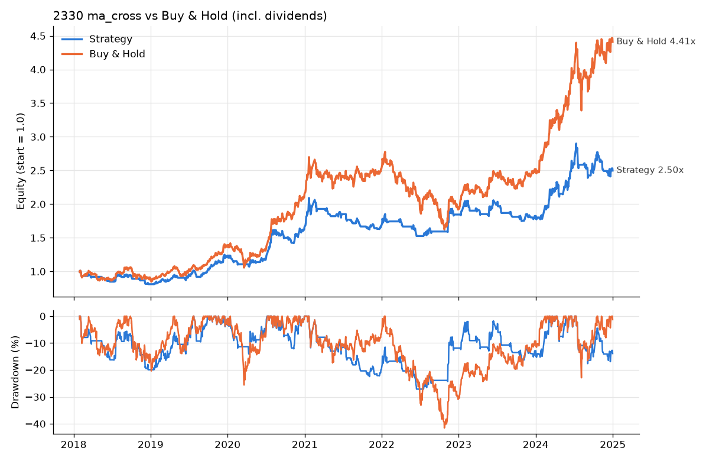
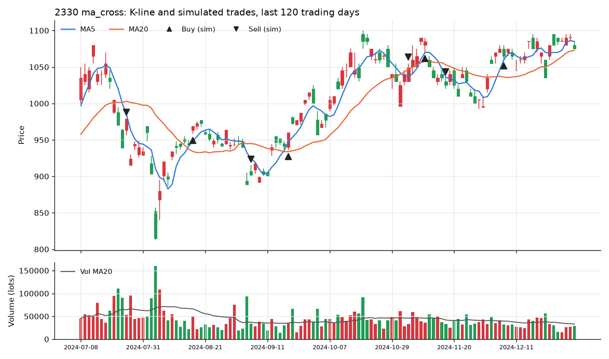

# 2330 回測報告：ma_cross

> 僅供研究與模擬，不構成投資建議；本工具不含任何下單功能。

- 資料期間：2018-01-02 ~ 2024-12-31（1705 個交易日）
- 保留期：2025-01-01 起。本報告資料截在保留期前一天，看不到保留期。
- 訊號用除權息還原價產生；成交用未還原價；持有中遇到除權息，股利（含配股折價值）於除權息日入帳，稅率 0.00%，不再投入
- 策略參數：`{'fast': 5, 'slow': 20}`
- 初始資金 5,000,000 元，單位：整張（1000 股）
- 成本：手續費 0.1425% × 折扣 1.0（最低 20 元，無條件捨去），賣出證交稅 0.3%
- 成交規則：第 t 天收盤後產生訊號，第 t+1 天開盤價成交；開盤漲停不買、開盤跌停不賣（記錄於下方）
- 流動性：每次買進最多 前 20 日均量 × 5%（不含成交當天）；賣出一次全賣

## 績效：開發期（2018-01-29 ~ 2024-12-31）

| 策略 | 總報酬 | 年化報酬 | 最大回撤 | Sharpe | 勝率 | 持股比例 | 交易次數（來回） | 手續費 | 證交稅 | 股利入帳 | 漲跌停跳過 | 資金不足跳過 | 期末資產 |
|---|---|---|---|---|---|---|---|---|---|---|---|---|---|
| ma_cross | 149.8% | 14.7% | -27.1% | 0.79 | 40.7% | 59% | 54 (109 筆成交) | 1,142,961 | 1,199,256 | 611,250 | 0 | 0 | 12,488,033 |
| 買進持有 | 340.9% | 24.8% | -41.6% | 1.00 | — | 100% | 0 (1 筆成交) | 6,931 | 0 | 1,491,690 | 0 | 0 | 22,045,759 |

**顯著性**：和 200 組「同樣持股比例與換手率」的隨機訊號比，策略年化 14.7% 勝過 80% 的隨機組（隨機中位數 10.1%、前 5% 門檻 18.5%），單尾 p = 0.209。p ≥ 0.05：無法和運氣區分。

## K 線型態與量價分析

型態出現後「隔日開盤買、5 個交易日後開盤賣」的歷史統計（未扣成本；事後統計，僅供研究，樣本少的型態不具參考性）。注意：統計期間涵蓋整段回測期，若依這張表回頭挑選策略型態或參數，就是資料窺探，回測結果會過度樂觀；要調參請改用回測期之前的資料或另留 holdout 期間：

| 型態 | 說明 | 次數 | 平均報酬 | 上漲比例 | 相對全部交易日 |
|---|---|---|---|---|---|
| doji | 十字線 | 176 | 0.57% | 50.6% | +0.00% |
| hammer | 錘子（下影線長，跌勢後） | 46 | 0.57% | 52.2% | -0.00% |
| shooting_star | 流星（上影線長，漲勢後） | 41 | 0.56% | 56.1% | -0.01% |
| bull_engulfing | 多頭吞噬 | 41 | 0.22% | 46.3% | -0.35% |
| bear_engulfing | 空頭吞噬 | 50 | 0.70% | 58.0% | +0.13% |
| three_white_soldiers | 紅三兵 | 58 | 0.03% | 43.1% | -0.55% |
| three_black_crows | 黑三兵 | 47 | 1.27% | 59.6% | +0.69% |
| long_red | 長紅（實體 > 近 20 日平均實體 2 倍） | 115 | 0.49% | 49.6% | -0.08% |
| long_black | 長黑（實體 > 近 20 日平均實體 2 倍） | 119 | 1.57% | 68.1% | +0.99% |
| volume_breakout | 帶量突破 20 日高點 | 62 | -0.04% | 48.4% | -0.61% |
| volume_breakdown | 帶量跌破 20 日低點 | 48 | 1.42% | 60.4% | +0.85% |
| all_days | 所有交易日（基準） | 1699 | 0.57% | 53.4% | +0.00% |

### 最近 10 個交易日

| 日期 | 型態 | 量 / 前5日均量 | 5日均量 / 20日均量 | OBV 斜率(20) | 收盤 / VWAP20 | MFI(14) |
|---|---|---|---|---|---|---|
| 2024-12-18 | — | 1.46x | 0.98x | +0.08 | +3.94% | 68 |
| 2024-12-19 | — | 1.27x | 1.09x | +0.08 | +2.12% | 67 |
| 2024-12-20 | 長黑 | 1.40x | 1.22x | -0.04 | -1.18% | 57 |
| 2024-12-23 | 長紅 | 0.70x | 1.20x | +0.08 | +2.83% | 55 |
| 2024-12-24 | 長黑 | 0.68x | 1.15x | +0.12 | +2.53% | 55 |
| 2024-12-25 | — | 0.38x | 1.00x | +0.19 | +2.67% | 50 |
| 2024-12-26 | 十字線 | 0.41x | 0.86x | +0.15 | +2.32% | 56 |
| 2024-12-27 | — | 0.87x | 0.70x | +0.25 | +2.27% | 56 |
| 2024-12-30 | 十字線 | 1.14x | 0.68x | +0.20 | +2.01% | 64 |
| 2024-12-31 | — | 1.27x | 0.69x | +0.09 | +0.46% | 64 |

量價指標說明：OBV 斜率 > 0 代表近 20 日上漲日的量較多；收盤 / VWAP20 > 0 代表收盤高於近 20 日量加權均價；MFI > 80 偏過熱、< 20 偏超賣。

## 跳過紀錄

漲跌停跳過：無。

買進股數受均量上限限制的次數：0 / 55。

## Oracle 檢查（在本次資料上執行）

| 檢查 | 結果 | 說明 |
|---|---|---|
| 作弊模型（偷看明日報酬）年化 > 100% | PASS | 作弊策略年化報酬 277.3%（門檻 100%） |
| 成交時點：第 t 天訊號於第 t+1 天開盤成交 | PASS | 預期 [('2024-01-03', 'buy', 102.0), ('2024-01-05', 'sell', 104.0)]，實際 [('2024-01-03', 'buy', 102.0), ('2024-01-05', 'sell', 104.0)] |
| 手算小交易成本 = 引擎結果 | PASS | 整張：100 元買 1 張，手續費 floor(142.5)=142；110 元賣，手續費 floor(156.75)=156、證交稅 330：預期 209,372，引擎 209,372.00 OK；零股：100 元買 9 股，手續費 1.28→最低 20；110 元賣，手續費最低 20、證交稅 floor(2.97)=2：預期 1,048，引擎 1,048.00 OK |
| 隨機訊號扣成本後年化明顯低於買進持有 | PASS | 買進持有年化 25.0%；隨機訊號 20 次平均 -20.5%、最佳 -12.2%（要求平均低於買進持有 5% 以上，且最佳也低於） |
| 特徵截斷不變性（無 look-ahead） | **FAIL** | 檢查 8 個截斷點，不一致：2022-03-08: ['mfi_14'] |

pytest 另外驗證：三個故意埋錯的版本（當天收盤成交、忘記扣證交稅、特徵往未來偏移一天）都會被上述檢查擋下（tests/test_oracles.py）。
