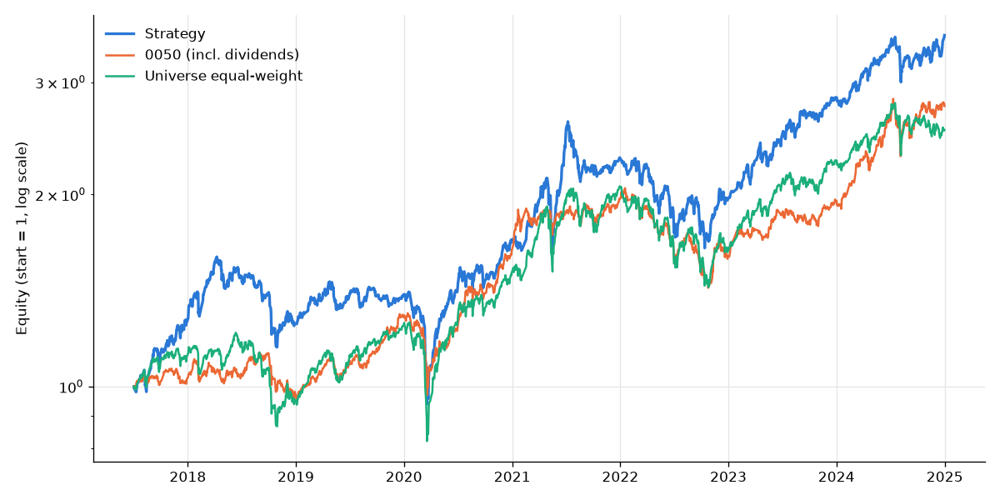

# 策略實驗室：ai_illiquidity_quality

> 僅供研究與模擬，不構成投資建議；本工具不含任何下單功能。只用開發期（保留期之前），實驗室沒有保留期選項。

## 策略檔（事前登記）

- 登記日：2026-11-26　規則雜湊：`26892b6e`
- 提出者：AI
- 誰在賠錢：需要隨時能大量進出的投資人（法人、短線交易者）偏好熱門股，願意為流動性付出較低的預期報酬；長期持有、不需要頻繁交易的人可以賺到這份補償
- 依據：Amihud & Mendelson (1986) 買賣價差與資產定價；Amihud (2002) 非流動性溢酬；Asness, Frazzini, Israel, Moskowitz & Pedersen (2018) Size Matters, If You Control Your Junk（排除體質差的公司後，小型 / 低流動性溢酬才明顯）
- 家族：liquidity
- 假設：在通過基本流動性門檻的股票中，成交金額較低、但近四季有獲利的公司，長期報酬高於大盤與隨機選股
- 理由：持有成交冷清的股票要承擔較高的交易成本與難以快速脫手的風險，投資人會要求額外報酬作為補償；先排除虧損公司，避免只選到體質差、因此沒人交易的股票
- 失效條件：開發期報酬主要來自少數幾檔；或成交量上限讓大部分目標買不足；或兩段期間中有一段明顯輸給 0050
- 規則：每 126 個交易日，篩選 股價 > 10、20 日均成交金額 > 50 百萬、eps_ttm > 0（mom = 近 126 日漲幅）；依 turnover 由小到大取前 20 檔等權；t 收盤決定、t+1 開盤成交；零股；含成本、股利、公司行動
- 參數：universe=full、rebalance_days=126、top_n=20、lookback=126、filters=[eps_ttm > 0]、rank_by=turnover asc
- 股票池：全市場上市櫃普通股中，曾在某個調整日通過流動性門檻的 1637 檔（含已下市；下市股以最後收盤出清，對破產下市偏樂觀）；實際載入 1631 檔
- 基本面只用當時已公布的資料（src/fundamentals.py）；FinMind 只有最新版本，沒有當時公告的原始數字
- 成交量上限：每檔每天買進 ≤ 前 20 日均量 × 0.05；對照組股票池為各調整日當天通過門檻的股票（平均 487 檔）
- 重現資訊：設定 6058a3df、資料截止 2024-12-31、資料快照 69782003、程式 e433b8b+未提交修改、python 3.12.3、pandas 3.1.0、numpy 2.5.4、lightgbm 4.7.0、產生於 2026-11-26 17:06（逐檔雜湊：ai_illiquidity_quality_20261126.data.json）

## 總判定：不通過

全部檢驗都過才算通過；「通過」只代表開發期證據過門檻，不是投資建議，也不是樣本外證據。

| 檢驗 | 數字 | 結果 |
|---|---|---|
| 對 0050 含息 | Sharpe 0.95 vs 0.91；最大回撤 -41.3% vs -30.2%（容許深 10 個百分點） | 不過 |
| 配對隨機選股（前 5%） | 年化 p = 0.089、Sharpe p = 0.059（100 組） | 不過 |
| 鄰近參數 | Sharpe 勝過 0050：3 / 6 組（至少 5 組） | 不過 |
| 前後兩段 | 2017-07-03~2021-04-02 Sharpe 1.05 vs 1.12；2021-04-03~2024-12-31 Sharpe 0.85 vs 0.70 | 不過 |
| 兩倍成本 | Sharpe 0.89（年化 17.9%）vs 0050 0.91 | 不過 |
| 下市持股歸零 | Sharpe 0.95（年化 19.0%）vs 0050 0.91；遇到下市 0 次 | 過 |
| 拿掉貢獻最大 3 檔 | 5314 世紀*、2636 台驊控股、9958 世紀鋼 從股票池移除後重跑：Sharpe 0.73（年化 13.6%）vs 0050 0.91 | 不過 |
| 拿掉最好的一年 | 策略最好的年度 2023（+44.5%）；兩邊都移除該年日報酬後 Sharpe 0.78 vs 0050 0.82 | 不過 |
| 多重比較（Bonferroni） | 隨機選股較大的 p 0.089 × 規則數 4 = 0.356 | 不過 |

## 績效（2017-07-03 ~ 2024-12-31）

| 組合 | 年化 | 最大回撤 | Sharpe | 年週轉率 | 成本 | 股利 |
|---|---|---|---|---|---|---|
| 策略 | 19.0% | -41.3% | 0.95 | 2.0x | 775,766 | 3,546,738 |
| 0050 含息 | 14.9% | -30.2% | 0.91 | 0.1x | 7,053 | 1,667,409 |
| 股票池等權 | 13.6% | -34.9% | 0.73 | 0.8x | 296,869 | 2,610,482 |
| 策略（壓力：下市持股歸零） | 19.0% | -41.3% | 0.95 | 2.0x | 775,766 | 3,546,738 |

## 小額帳戶情境（本金 20,000 元、最低手續費 20 元；不影響判定）

同一份凍結的目標股，只換本金與最低手續費，其餘成本沿用 costs 區段；整張以下以零股（1 股）為單位成交。

| 項目 | 數字 |
|---|---|
| 年化 | 13.6% |
| 最大回撤 | -47.4% |
| Sharpe | 0.71 |
| 總成本（元） | 12,776 |
| 成本佔平均淨值的年化比例 | 5.49%（主回測 1.08%） |
| 與主回測年化的差距 | -5.4%（主回測 19.0%） |
| 因每檔分到的金額買不到 1 股而沒買到的目標 | 0 / 300 次 |

買不到的次數是近似：以各調整日收盤淨值 × 0.99（現金緩衝）÷ 目標檔數，除以當天收盤價，不足 1 股就計一次；沒考慮成交量上限、漲停或現金不足等其他原因。

**配對隨機選股**（100 組，同池、同檔數、同換手）

| 指標 | 策略 | 隨機中位數 | 隨機前 5% 門檻 | 策略勝過 | 單尾 p |
|---|---|---|---|---|---|
| 年化 | 19.0% | 12.4% | 20.2% | 92% | 0.089 |
| Sharpe | 0.95 | 0.64 | 0.94 | 95% | 0.059 |

**鄰近參數**

| 變動 | Sharpe | 年化 | 勝過 0050 |
|---|---|---|---|
| top_n ×0.8 | 0.87 | 17.6% | 否 |
| top_n ×1.2 | 1.11 | 22.6% | 是 |
| lookback ×0.8 | 0.95 | 19.0% | 是 |
| lookback ×1.2 | 0.95 | 19.0% | 是 |
| rebalance_days ×0.8 | 0.86 | 16.7% | 否 |
| rebalance_days ×1.2 | 0.59 | 10.3% | 否 |

**稽核方法備註**
- 拿掉貢獻最大 3 檔：各股損益 = 賣出淨額 − 買進成本 + 期末持股市值（不含股利、不處理公司行動造成的股數變化，是近似排序）；找出前 3 檔後從股票池移除、重新選股重跑
- 拿掉最好的一年：以策略各年度複利報酬最高的年度為準，策略與 0050 都移除該年度的日報酬後重算 Sharpe
- 前後兩段：開發期依日期對半切；兩倍成本：手續費與證交稅都乘 2

## 試驗帳本

至今不同規則數 N = 4（依規則雜湊去重，含本次；同一規則重跑不增加）。隨機選股較大的 p = 0.089，Bonferroni 後 min(1, p × N) = 0.356；不顯著，不通過（門檻 0.05）。

以 n_random = 100，單次最小可達 p = 1/(K+1) = 0.0099，Bonferroni 後最小可達 p = min(1, N/(K+1)) = 0.0396。

其中使用者 3 個、AI 1 個。
帳本：reports/lab/trials.csv（只追加不改）。
