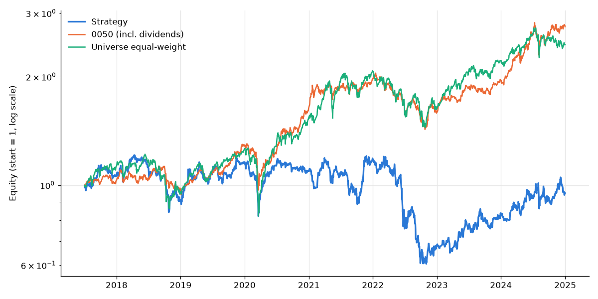

# 策略實驗室：cheap_growth

> 僅供研究與模擬，不構成投資建議；本工具不含任何下單功能。只用開發期（保留期之前），實驗室沒有保留期選項。

## 策略檔（事前登記）

- 登記日：2026-11-16　規則雜湊：`5199915f`
- 假設：便宜又在成長的股票，之後會表現較好
- 理由：還沒有接到大訂單，市場還沒注意到，所以股價便宜；成長被看見後股價會補上
- 失效條件：大跌；或預測的趨勢相反（營收成長沒有延續）
- 規則：每 63 個交易日，篩選 股價 > 10、20 日均成交金額 > 50 百萬、pe < 15、yoy3 > 0.1（mom = 近 126 日漲幅）；依 pe 由小到大取前 5 檔等權；t 收盤決定、t+1 開盤成交；零股；含成本、股利、公司行動
- 參數：universe=full、rebalance_days=63、top_n=5、lookback=126、filters=[pe < 15、yoy3 > 0.1]、rank_by=pe asc
- 股票池：全市場上市櫃普通股中，曾在某個調整日通過流動性門檻的 1637 檔（含已下市；下市股以最後收盤出清，對破產下市偏樂觀）；實際載入 1631 檔
- 基本面只用當時已公布的資料（src/fundamentals.py）；FinMind 只有最新版本，沒有當時公告的原始數字
- 成交量上限：每檔每天買進 ≤ 前 20 日均量 × 0.05；對照組股票池為各調整日當天通過門檻的股票（平均 494 檔）
- 重現資訊：設定 37d4b7c5、資料截止 2024-12-31、資料快照 20390144、程式 536d732+未提交修改、python 3.12.3、pandas 3.1.0、numpy 2.5.4、lightgbm 4.7.0、產生於 2026-11-16 17:27（逐檔雜湊：cheap_growth_20261116.data.json）

## 總判定：不通過

全部檢驗都過才算通過；「通過」只代表開發期證據過門檻，不是投資建議，也不是樣本外證據。

| 檢驗 | 數字 | 結果 |
|---|---|---|
| 對 0050 含息 | Sharpe 0.09 vs 0.91；最大回撤 -50.1% vs -30.2%（容許深 10 個百分點） | 不過 |
| 配對隨機選股（前 5%） | 年化 p = 0.960、Sharpe p = 0.960（100 組） | 不過 |
| 鄰近參數 | Sharpe 勝過 0050：0 / 10 組（至少 8 組） | 不過 |
| 前後兩段 | 2017-07-03~2021-04-02 Sharpe 0.33 vs 1.12；2021-04-03~2024-12-31 Sharpe -0.09 vs 0.70 | 不過 |
| 兩倍成本 | Sharpe 0.01（年化 -2.5%）vs 0050 0.91 | 不過 |
| 下市持股歸零 | Sharpe 0.09（年化 -0.7%）vs 0050 0.91；遇到下市 0 次 | 不過 |
| 拿掉貢獻最大 3 檔 | 2408 南亞科、2388 威盛、2603 長榮 從股票池移除後重跑：Sharpe -0.12（年化 -5.3%）vs 0050 0.91 | 不過 |
| 拿掉最好的一年 | 策略最好的年度 2019（+27.0%）；兩邊都移除該年日報酬後 Sharpe -0.07 vs 0050 0.76 | 不過 |
| 多重比較（Bonferroni） | 隨機選股較大的 p 0.960 × 規則數 3 = 1.000 | 不過 |

## 績效（2017-07-03 ~ 2024-12-31）

| 組合 | 年化 | 最大回撤 | Sharpe | 年週轉率 | 成本 | 股利 |
|---|---|---|---|---|---|---|
| 策略 | -0.7% | -50.1% | 0.09 | 3.2x | 637,882 | 2,490,330 |
| 0050 含息 | 14.9% | -30.2% | 0.91 | 0.1x | 7,053 | 1,667,409 |
| 股票池等權 | 13.2% | -35.2% | 0.70 | 1.2x | 558,564 | 2,596,201 |
| 策略（壓力：下市持股歸零） | -0.7% | -50.1% | 0.09 | 3.2x | 637,882 | 2,490,330 |

**配對隨機選股**（100 組，同池、同檔數、同換手）

| 指標 | 策略 | 隨機中位數 | 隨機前 5% 門檻 | 策略勝過 | 單尾 p |
|---|---|---|---|---|---|
| 年化 | -0.7% | 12.1% | 23.6% | 4% | 0.960 |
| Sharpe | 0.09 | 0.56 | 0.89 | 4% | 0.960 |

**鄰近參數**

| 變動 | Sharpe | 年化 | 勝過 0050 |
|---|---|---|---|
| top_n ×0.8 | 0.06 | -1.6% | 否 |
| top_n ×1.2 | 0.09 | -0.6% | 否 |
| lookback ×0.8 | 0.09 | -0.7% | 否 |
| lookback ×1.2 | 0.09 | -0.7% | 否 |
| rebalance_days ×0.8 | -0.03 | -3.7% | 否 |
| rebalance_days ×1.2 | 0.14 | 0.4% | 否 |
| pe < 12（×0.8） | 0.09 | -0.7% | 否 |
| pe < 18（×1.2） | 0.09 | -0.7% | 否 |
| yoy3 > 0.08（×0.8） | 0.08 | -0.8% | 否 |
| yoy3 > 0.12（×1.2） | 0.15 | 0.8% | 否 |

**稽核方法備註**
- 拿掉貢獻最大 3 檔：各股損益 = 賣出淨額 − 買進成本 + 期末持股市值（不含股利、不處理公司行動造成的股數變化，是近似排序）；找出前 3 檔後從股票池移除、重新選股重跑
- 拿掉最好的一年：以策略各年度複利報酬最高的年度為準，策略與 0050 都移除該年度的日報酬後重算 Sharpe
- 前後兩段：開發期依日期對半切；兩倍成本：手續費與證交稅都乘 2

## 試驗帳本

至今不同規則數 N = 3（依規則雜湊去重，含本次；同一規則重跑不增加）。隨機選股較大的 p = 0.960，Bonferroni 後 min(1, p × N) = 1.000；不顯著，不通過（門檻 0.05）。

以 n_random = 100，單次最小可達 p = 1/(K+1) = 0.0099，Bonferroni 後最小可達 p = min(1, N/(K+1)) = 0.0297。

帳本：reports/lab/trials.csv（只追加不改）。
