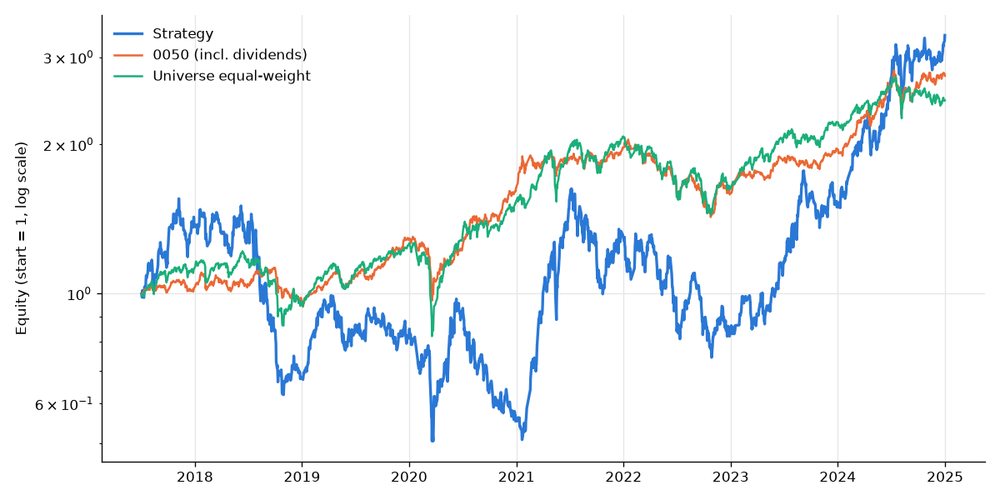

# 策略實驗室：global_trend_momentum

> 僅供研究與模擬，不構成投資建議；本工具不含任何下單功能。只用開發期（保留期之前），實驗室沒有保留期選項。

## 策略檔（事前登記）

- 登記日：2026-11-16　規則雜湊：`cbf75b0d`
- 假設：跟著世界趨勢發展的股票，股價會先走強、營收也明顯加速，之後幾個月仍會表現較好
- 理由：財報落後趨勢，等財報出來才買就太晚了；股價會比財報更早反映趨勢
- 失效條件：選舉或重大事件發生時；或股價強且營收高成長的股票，之後一季落後 0050
- 規則：每 63 個交易日，篩選 股價 > 10、20 日均成交金額 > 50 百萬、yoy3 > 0.2、eps_ttm > 0、mom > 0（mom = 近 126 日漲幅）；依 mom 由大到小取前 5 檔等權；t 收盤決定、t+1 開盤成交；零股；含成本、股利、公司行動
- 參數：universe=full、rebalance_days=63、top_n=5、lookback=126、filters=[yoy3 > 0.2、eps_ttm > 0、mom > 0]、rank_by=mom desc
- 股票池：全市場上市櫃普通股中，曾在某個調整日通過流動性門檻的 1637 檔（含已下市；下市股以最後收盤出清，對破產下市偏樂觀）；實際載入 1631 檔
- 基本面只用當時已公布的資料（src/fundamentals.py）；FinMind 只有最新版本，沒有當時公告的原始數字
- 成交量上限：每檔每天買進 ≤ 前 20 日均量 × 0.05；對照組股票池為各調整日當天通過門檻的股票（平均 494 檔）
- 重現資訊：設定 37d4b7c5、資料截止 2024-12-31、資料快照 ae978e2b、程式 0f3e636+未提交修改、python 3.12.3、pandas 3.1.0、numpy 2.5.4、lightgbm 4.7.0、產生於 2026-11-16 12:25（逐檔雜湊：global_trend_momentum_20261116.data.json）

## 總判定：不通過

全部檢驗都過才算通過；「通過」只代表開發期證據過門檻，不是投資建議，也不是樣本外證據。

| 檢驗 | 數字 | 結果 |
|---|---|---|
| 對 0050 含息 | Sharpe 0.60 vs 0.91；最大回撤 -67.6% vs -30.2%（容許深 10 個百分點） | 不過 |
| 配對隨機選股（前 5%） | 年化 p = 0.149、Sharpe p = 0.297（100 組） | 不過 |
| 鄰近參數 | Sharpe 勝過 0050：0 / 8 組（至少 6 組） | 不過 |
| 前後兩段 | 2017-07-03~2021-04-02 Sharpe 0.21 vs 1.12；2021-04-03~2024-12-31 Sharpe 0.94 vs 0.70 | 不過 |
| 兩倍成本 | Sharpe 0.55（年化 15.4%）vs 0050 0.91 | 不過 |
| 下市持股歸零 | Sharpe 0.60（年化 18.0%）vs 0050 0.91；遇到下市 0 次 | 不過 |
| 拿掉貢獻最大 3 檔 | 6640 均華、6442 光聖、2609 陽明 從股票池移除後重跑：Sharpe 0.53（年化 14.5%）vs 0050 0.91 | 不過 |
| 拿掉最好的一年 | 策略最好的年度 2021（+133.3%）；兩邊都移除該年日報酬後 Sharpe 0.34 vs 0050 0.87 | 不過 |
| 多重比較（Bonferroni） | 隨機選股較大的 p 0.297 × 規則數 2 = 0.594 | 不過 |

## 績效（2017-07-03 ~ 2024-12-31）

| 組合 | 年化 | 最大回撤 | Sharpe | 年週轉率 | 成本 | 股利 |
|---|---|---|---|---|---|---|
| 策略 | 18.0% | -67.6% | 0.60 | 3.4x | 869,394 | 2,038,448 |
| 0050 含息 | 14.9% | -30.2% | 0.91 | 0.1x | 7,053 | 1,667,409 |
| 股票池等權 | 13.2% | -35.2% | 0.70 | 1.2x | 558,564 | 2,596,201 |
| 策略（壓力：下市持股歸零） | 18.0% | -67.6% | 0.60 | 3.4x | 869,394 | 2,038,448 |

**配對隨機選股**（100 組，同池、同檔數、同換手）

| 指標 | 策略 | 隨機中位數 | 隨機前 5% 門檻 | 策略勝過 | 單尾 p |
|---|---|---|---|---|---|
| 年化 | 18.0% | 9.3% | 23.2% | 86% | 0.149 |
| Sharpe | 0.60 | 0.47 | 0.90 | 71% | 0.297 |

**鄰近參數**

| 變動 | Sharpe | 年化 | 勝過 0050 |
|---|---|---|---|
| top_n ×0.8 | 0.34 | 5.4% | 否 |
| top_n ×1.2 | 0.72 | 23.6% | 否 |
| lookback ×0.8 | 0.39 | 7.8% | 否 |
| lookback ×1.2 | 0.67 | 22.4% | 否 |
| rebalance_days ×0.8 | 0.71 | 24.8% | 否 |
| rebalance_days ×1.2 | 0.70 | 23.5% | 否 |
| yoy3 > 0.16（×0.8） | 0.47 | 11.5% | 否 |
| yoy3 > 0.24（×1.2） | 0.70 | 23.3% | 否 |

**稽核方法備註**
- 拿掉貢獻最大 3 檔：各股損益 = 賣出淨額 − 買進成本 + 期末持股市值（不含股利、不處理公司行動造成的股數變化，是近似排序）；找出前 3 檔後從股票池移除、重新選股重跑
- 拿掉最好的一年：以策略各年度複利報酬最高的年度為準，策略與 0050 都移除該年度的日報酬後重算 Sharpe
- 前後兩段：開發期依日期對半切；兩倍成本：手續費與證交稅都乘 2

## 試驗帳本

至今不同規則數 N = 2（依規則雜湊去重，含本次；同一規則重跑不增加）。隨機選股較大的 p = 0.297，Bonferroni 後 min(1, p × N) = 0.594；不顯著，不通過（門檻 0.05）。

以 n_random = 100，單次最小可達 p = 1/(K+1) = 0.0099，Bonferroni 後最小可達 p = min(1, N/(K+1)) = 0.0198。

帳本：reports/lab/trials.csv（只追加不改）。
