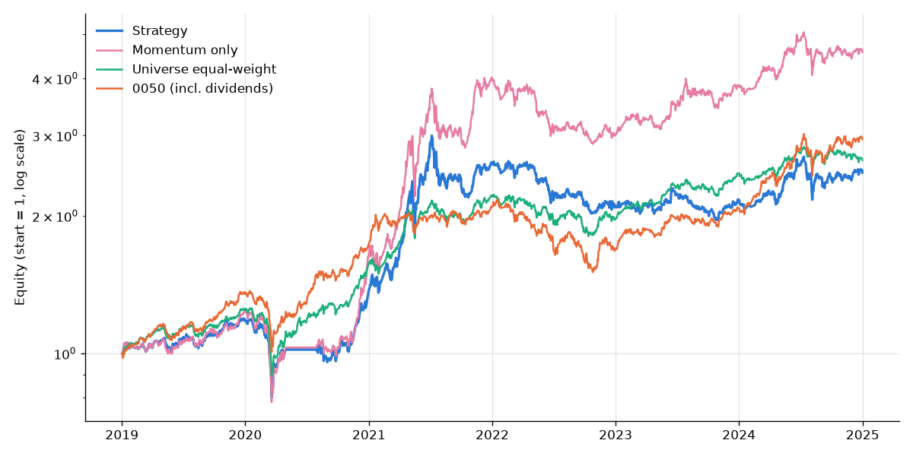

# 選股排名策略研究

> 僅供研究與模擬，不構成投資建議；本工具不含任何下單功能。

- 股票池：40 檔（config `evaluation.universe`，皆為現存上市公司，有存活者偏差）
- 規則：每 63 個交易日，篩選 近 63 日漲幅 > 0、近 126 日漲幅 > 0、近 3 個月營收年增 > 0、近四季 EPS > 0、股價 > 10、20 日均成交金額 > 20 百萬，依近 126 日漲幅取前 8 檔等權；t 收盤決定、t+1 開盤成交；零股；含成本、股利、公司行動
- 基本面只用當時已公布的資料：月營收次月 10 日、季報季末 + 45 天、年報 + 90 天
- 保留期 2025-01-01 起，本報告看不到保留期

## 開發期（2019-01-02 ~ 2024-12-31）

| 組合 | 年化 | 最大回撤 | Sharpe | 年週轉率 | 成本 | 股利 |
|---|---|---|---|---|---|---|
| 策略 | 17.1% | -34.6% | 0.80 | 2.7x | 819,290 | 2,641,789 |
| 純動能（無基本面） | 30.0% | -37.4% | 1.12 | 2.4x | 1,076,107 | 3,627,924 |
| 股票池等權 | 18.4% | -28.6% | 1.14 | 0.3x | 71,456 | 2,655,033 |
| 0050 含息 | 20.5% | -30.9% | 1.14 | 0.1x | 7,029 | 1,570,881 |

**顯著性**：和 100 組「每次隨機挑 8 檔」的組合比，策略年化 17.1% 勝過 63%（隨機中位數 16.0%、前 5% 門檻 24.7%），單尾 p = 0.376。

## 穩健性檢查（開發期）

比較基準：0050 含息 Sharpe 1.14、年化 20.5%。

**1. 鄰近參數**（Sharpe，括號為年化）

| 持股檔數 ＼ 動能回看天數 | 105 | 126 | 147 |
|---|---|---|---|
| 6 | 0.97（23.9%） | 0.81（19.6%） | 0.90（22.1%） |
| 8 | 0.89（19.2%） | 0.80（17.1%） | 0.75（15.6%） |
| 10 | 0.90（18.1%） | 0.77（15.2%） | 0.76（14.8%） |

Sharpe 勝過 0050：0 / 9 組（標準：至少 7 組）

**2. 前後兩段**

| 期間 | 策略 Sharpe | 0050 Sharpe | 策略年化 | 0050 年化 |
|---|---|---|---|---|
| 2019-01-02 ~ 2022-01-01 | 1.35 | 1.57 | 39.4% | 29.0% |
| 2022-01-02 ~ 2024-12-31 | 0.01 | 0.72 | -1.4% | 12.4% |

**3. 交易成本**

| 成本 | 年化 | Sharpe | 最大回撤 |
|---|---|---|---|
| ×0 | 18.8% | 0.86 | -32.6% |
| ×1 | 17.1% | 0.80 | -34.6% |
| ×2 | 15.4% | 0.73 | -37.2% |

結論：鄰近參數 不過、前後兩段 不過、兩倍成本 不過。

## 開發期最後一次選股（2024-12-19）

| 股票 | 近 126 日 | 近 63 日 | 營收年增（3 月） | 近四季 EPS |
|---|---|---|---|---|
| 2618 長榮航 | +29.3% | +24.1% | +4.2% | 4.93 |
| 2881 富邦金 | +29.2% | +4.7% | +292.2% | 8.47 |
| 2357 華碩 | +27.5% | +10.7% | +24.8% | 45.34 |
| 2882 國泰金 | +21.9% | +7.3% | +32.1% | 6.21 |
| 2603 長榮 | +20.8% | +24.4% | +73.3% | 52.15 |
| 2308 台達電 | +20.5% | +8.0% | +8.5% | 14.26 |
| 2610 華航 | +17.2% | +26.4% | +9.7% | 1.69 |
| 2330 台積電 | +17.1% | +13.4% | +33.8% | 40.02 |
