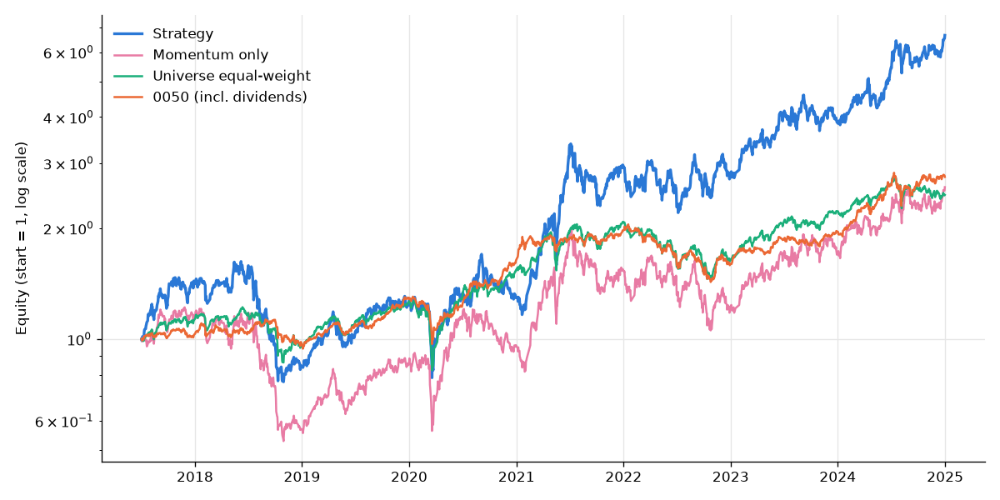

# 選股排名策略研究

> ⚠️ 此規則已淘汰（2026-10-30 保留期驗證失敗）。保留期已消耗，本報告只作紀錄與對照組方法的檢查，不是樣本外證據，也不能再用來調參。

> 僅供研究與模擬，不構成投資建議；本工具不含任何下單功能。

- 股票池：全市場上市櫃普通股中，曾在某個調整日通過流動性門檻的 1637 檔（含已下市；下市股以最後收盤出清，對破產下市偏樂觀）；實際載入 1631 檔
- 規則：每 63 個交易日，篩選 近 63 日漲幅 > 0、近 126 日漲幅 > 0、近 3 個月營收年增 > 0、近四季 EPS > 0、股價 > 10、20 日均成交金額 > 50 百萬，依近 126 日漲幅取前 10 檔等權；t 收盤決定、t+1 開盤成交；零股；含成本、股利、公司行動
- 基本面只用當時已公布的資料：月營收次月 10 日；季報一般公司季末 + 45 天、金融業 + 2 個月、年報 3/31；再加 1 天
- 保留期 2025-01-01 起，本報告看不到保留期
- 成交量上限：每檔每天買進 ≤ 前 20 日均量 × 0.05；對照組股票池為各調整日當天通過門檻的股票（平均 494 檔）
- 重現資訊：設定 8168b363、資料截止 2024-12-31、資料快照 7831eec4、程式 0983b3c、python 3.12.3、pandas 3.1.0、numpy 2.5.4、lightgbm 4.7.0、產生於 2026-10-30 19:29（逐檔雜湊：rank_study_full_20261030.data.json）

## 開發期（2017-07-03 ~ 2024-12-31）

| 組合 | 年化 | 最大回撤 | Sharpe | 年週轉率 | 成本 | 股利 |
|---|---|---|---|---|---|---|
| 策略 | 29.8% | -52.8% | 0.88 | 3.2x | 1,646,613 | 3,953,548 |
| 純動能（無基本面） | 13.9% | -56.6% | 0.53 | 3.4x | 908,758 | 1,448,395 |
| 股票池等權 | 13.2% | -35.2% | 0.70 | 1.2x | 559,136 | 2,599,740 |
| 0050 含息 | 14.9% | -30.2% | 0.91 | 0.1x | 7,053 | 1,667,409 |
| 策略（壓力：下市持股歸零） | 29.8% | -52.8% | 0.88 | 3.2x | 1,646,613 | 3,953,548 |

策略全期間遇到持股下市 / 資料結束 0 次；上表「策略」以最後收盤出清，壓力列以 0 計，真實結果介於兩者之間。

**顯著性**：和 100 組配對的隨機選股比（每次從當天通過價格 / 流動性門檻的股票抽，持股檔數與續抱檔數和策略相同）

| 指標 | 策略 | 隨機中位數 | 隨機前 5% 門檻 | 策略勝過 | 單尾 p |
|---|---|---|---|---|---|
| 年化 | 29.8% | 12.2% | 20.5% | 100% | 0.010 |
| Sharpe | 0.88 | 0.61 | 0.88 | 95% | 0.059 |

## 穩健性檢查（開發期）

比較基準：0050 含息 Sharpe 0.91、年化 14.9%。

**1. 鄰近參數**（Sharpe，括號為年化）

| 持股檔數 ＼ 動能回看天數 | 105 | 126 | 147 |
|---|---|---|---|
| 6 | 0.58（16.5%） | 0.56（15.9%） | 0.76（26.6%） |
| 8 | 0.77（25.5%） | 0.83（28.7%） | 1.03（39.7%） |
| 10 | 0.73（22.9%） | 0.88（29.8%） | 0.97（34.5%） |

Sharpe 勝過 0050：2 / 9 組（標準：至少 7 組）

**2. 前後兩段**

| 期間 | 策略 Sharpe | 0050 Sharpe | 策略年化 | 0050 年化 |
|---|---|---|---|---|
| 2017-07-03 ~ 2021-04-02 | 0.67 | 1.12 | 19.3% | 18.3% |
| 2021-04-03 ~ 2024-12-31 | 1.05 | 0.70 | 40.0% | 11.3% |

**3. 交易成本**

| 成本 | 年化 | Sharpe | 最大回撤 |
|---|---|---|---|
| ×0 | 32.2% | 0.93 | -52.1% |
| ×1 | 29.8% | 0.88 | -52.8% |
| ×2 | 27.3% | 0.83 | -53.6% |

結論：鄰近參數 不過、前後兩段 不過、兩倍成本 不過。

## 開發期最後一次選股（2024-12-24）

| 股票 | 近 126 日 | 近 63 日 | 營收年增（3 月） | 近四季 EPS |
|---|---|---|---|---|
| 8937 合騏* | +449.4% | +112.6% | +11.1% | 0.35 |
| 3293 鈊象 | +235.9% | +18.1% | +34.3% | 41.41 |
| 4583 台灣精銳 | +208.3% | +18.2% | +6.4% | 12.83 |
| 5314 世紀* | +184.6% | +185.0% | +640.7% | 10.30 |
| 3019 亞光 | +143.1% | +42.2% | +31.0% | 5.44 |
| 8114 振樺電 | +136.8% | +68.1% | +67.7% | 8.37 |
| 8032 光菱 | +134.3% | +51.5% | +29.0% | 1.40 |
| 8111 立碁 | +129.0% | +81.2% | +9.5% | 0.39 |
| 1736 喬山 | +125.7% | +53.0% | +34.7% | 4.22 |
| 3450 聯鈞 | +119.7% | +43.1% | +66.3% | 1.81 |
