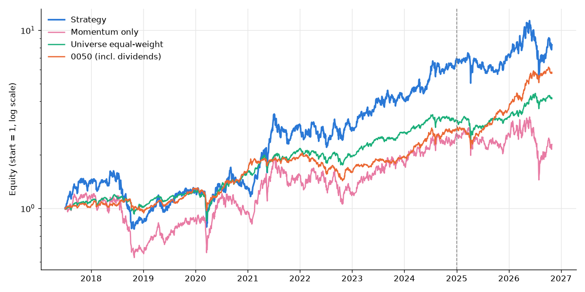

# 選股排名策略研究（含保留期）

> 僅供研究與模擬，不構成投資建議；本工具不含任何下單功能。

- 股票池：全市場上市櫃普通股中，曾在某個調整日通過流動性門檻的 1494 檔（含已下市；下市股以最後收盤出清，對破產下市偏樂觀）；實際載入 1494 檔
- 規則：每 63 個交易日，篩選 近 63 日漲幅 > 0、近 126 日漲幅 > 0、近 3 個月營收年增 > 0、近四季 EPS > 0、股價 > 10、20 日均成交金額 > 50 百萬，依近 126 日漲幅取前 10 檔等權；t 收盤決定、t+1 開盤成交；零股；含成本、股利、公司行動
- 基本面只用當時已公布的資料：月營收次月 10 日；季報一般公司季末 + 45 天、金融業 + 2 個月、年報 3/31；再加 1 天
- 保留期 2025-01-01 起，**本報告包含保留期（第 1 次查看）**

## 開發期（2017-07-03 ~ 2024-12-31）

| 組合 | 年化 | 最大回撤 | Sharpe | 年週轉率 | 成本 | 股利 |
|---|---|---|---|---|---|---|
| 策略 | 30.6% | -52.8% | 0.89 | 3.3x | 1,671,693 | 4,024,417 |
| 純動能（無基本面） | 14.3% | -56.6% | 0.54 | 3.4x | 914,608 | 1,456,293 |
| 股票池等權 | 16.9% | -32.6% | 1.03 | 0.4x | 870,585 | 2,593,130 |
| 0050 含息 | 14.9% | -30.2% | 0.91 | 0.1x | 7,053 | 1,667,409 |

**顯著性**：和 100 組「每次隨機挑 10 檔」的組合比，策略年化 30.6% 勝過 100%（隨機中位數 14.9%、前 5% 門檻 23.7%），單尾 p = 0.010。

## 保留期（2025-01-01 ~ 2026-10-29）

| 組合 | 年化 | 最大回撤 | Sharpe | 年週轉率 | 成本 | 股利 |
|---|---|---|---|---|---|---|
| 策略 | 12.3% | -53.3% | 0.48 | 3.3x | 1,207,780 | 3,697,622 |
| 純動能（無基本面） | -6.6% | -55.7% | 0.09 | 3.4x | 419,460 | 864,109 |
| 股票池等權 | 18.1% | -29.0% | 0.85 | 0.4x | 228,941 | 1,127,591 |
| 0050 含息 | 54.1% | -23.9% | 1.88 | 0.1x | 0 | 648,531 |

**顯著性**：和 100 組「每次隨機挑 10 檔」的組合比，策略年化 12.3% 勝過 46%（隨機中位數 14.3%、前 5% 門檻 44.5%），單尾 p = 0.545。

## 穩健性檢查（開發期）

比較基準：0050 含息 Sharpe 0.91、年化 14.9%。

**1. 鄰近參數**（Sharpe，括號為年化）

| 持股檔數 ＼ 動能回看天數 | 105 | 126 | 147 |
|---|---|---|---|
| 6 | 0.58（17.0%） | 0.59（17.1%） | 0.79（28.2%） |
| 8 | 0.78（26.0%） | 0.85（29.4%） | 1.05（40.8%） |
| 10 | 0.76（24.2%） | 0.89（30.6%） | 0.97（34.8%） |

Sharpe 勝過 0050：2 / 9 組（標準：至少 7 組）

**2. 前後兩段**

| 期間 | 策略 Sharpe | 0050 Sharpe | 策略年化 | 0050 年化 |
|---|---|---|---|---|
| 2017-07-03 ~ 2021-04-02 | 0.67 | 1.12 | 19.3% | 18.3% |
| 2021-04-03 ~ 2024-12-31 | 1.08 | 0.70 | 41.7% | 11.3% |

**3. 交易成本**

| 成本 | 年化 | Sharpe | 最大回撤 |
|---|---|---|---|
| ×0 | 33.0% | 0.94 | -52.1% |
| ×1 | 30.6% | 0.89 | -52.8% |
| ×2 | 28.0% | 0.84 | -53.6% |

結論：鄰近參數 不過、前後兩段 不過、兩倍成本 不過。

## 開發期最後一次選股（2024-12-24）

| 股票 | 近 126 日 | 近 63 日 | 營收年增（3 月） | 近四季 EPS |
|---|---|---|---|---|
| 8937 合騏* | +449.4% | +112.6% | +11.1% | 0.35 |
| 3293 鈊象 | +235.9% | +18.1% | +34.3% | 41.41 |
| 4583 台灣精銳 | +208.3% | +18.2% | +6.4% | 12.83 |
| 5314 世紀* | +184.6% | +185.0% | +640.7% | 10.30 |
| 3019 亞光 | +143.1% | +42.2% | +31.0% | 5.44 |
| 8114 振樺電 | +136.8% | +68.1% | +67.7% | 8.37 |
| 8032 光菱 | +134.3% | +51.5% | +29.0% | 1.40 |
| 8111 立碁 | +129.0% | +81.2% | +9.5% | 0.39 |
| 1736 喬山 | +125.7% | +53.0% | +34.7% | 4.22 |
| 3450 聯鈞 | +119.7% | +43.1% | +66.3% | 1.81 |
