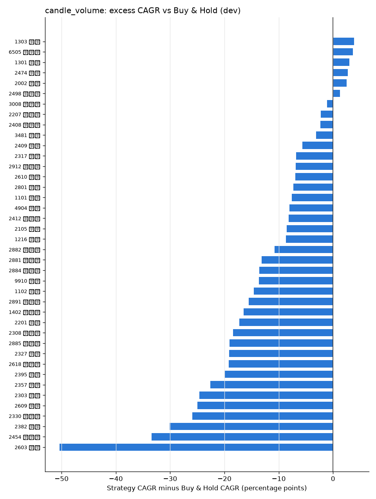

# 多檔研究：candle_volume

> 僅供研究與模擬，不構成投資建議；本工具不含任何下單功能。

- 股票池：40 檔（config.yaml `evaluation.universe`），成功 40 檔
- 策略參數：`{'trend_ma': 20, 'vol_confirm': 1.5, 'max_hold': 20}`
- 保留期：2025-01-01 起。本報告看不到保留期。
- 買進持有與策略都含股利；訊號用還原價、成交用未還原價；成本、漲跌停、流動性規則同單檔回測
- 顯著性：每檔和 200 組同持股比例 / 換手率的隨機訊號比較
- **存活者偏差**：股票池都是現在仍上市的公司，已下市的股票不在裡面，所有結果都偏樂觀

## 開發期

| 項目 | 結果 |
|---|---|
| 年化報酬贏買進持有 | 6 / 40 檔（符號檢定 p = 1.000） |
| 年化超額報酬中位數 | -9.7%（平均 -12.2%） |
| 顯著勝過隨機訊號（p < 0.05） | 3 / 40 檔（純運氣預期約 2.0 檔） |
| 勝過隨機訊號的平均百分位 | 44%（無選時能力時約 50%） |
| 最大回撤比買進持有小 | 26 / 40 檔 |
| Sharpe 比買進持有高 | 4 / 40 檔 |
| 平均持股比例 / 平均來回次數 | 16% / 40 |

| 股票 | 期間 | 策略年化 | 買進持有年化 | 超額 | 策略 MDD | 買進持有 MDD | Sharpe（策略 / 買持） | 持股比例 | 來回 | 成本 | 隨機百分位 | p 值 |
|---|---|---|---|---|---|---|---|---|---|---|---|---|
| 1303 南亞 | 2018-01-29 ~ 2024-12-31 | -1.6% | -5.5% | +3.9% | -17.6% | -48.3% | -0.22 / -0.24 | 11% | 25 | 725,323 | 74% | 0.269 |
| 6505 台塑化 | 2018-01-29 ~ 2024-12-31 | -7.4% | -11.1% | +3.7% | -47.1% | -62.8% | -0.85 / -0.45 | 10% | 34 | 795,046 | 14% | 0.856 |
| 1301 台塑 | 2018-01-29 ~ 2024-12-31 | -3.3% | -6.3% | +3.0% | -23.5% | -50.7% | -0.41 / -0.27 | 13% | 30 | 774,071 | 60% | 0.398 |
| 2474 可成 | 2018-01-29 ~ 2024-12-31 | 0.1% | -2.6% | +2.7% | -17.9% | -50.7% | 0.07 / 0.02 | 16% | 32 | 990,336 | 79% | 0.214 |
| 2002 中鋼 | 2018-01-29 ~ 2024-12-31 | 3.2% | 0.8% | +2.5% | -18.6% | -44.1% | 0.34 / 0.14 | 15% | 34 | 1,186,432 | 98% | 0.030 |
| 2498 宏達電 | 2018-01-29 ~ 2024-12-31 | -3.8% | -5.1% | +1.3% | -43.0% | -61.0% | -0.12 / 0.09 | 15% | 46 | 1,190,128 | 63% | 0.373 |
| 3008 大立光 | 2018-01-29 ~ 2024-12-31 | -3.5% | -2.4% | -1.1% | -32.7% | -53.4% | -0.28 / 0.06 | 15% | 39 | 684,793 | 44% | 0.557 |
| 2207 和泰車 | 2018-01-29 ~ 2024-12-31 | 5.0% | 7.3% | -2.3% | -24.4% | -41.1% | 0.45 / 0.43 | 17% | 48 | 1,791,354 | 95% | 0.055 |
| 2408 南亞科 | 2018-01-29 ~ 2024-12-31 | -9.2% | -6.9% | -2.3% | -49.6% | -57.7% | -0.64 / -0.06 | 15% | 44 | 887,235 | 24% | 0.766 |
| 3481 群創 | 2018-01-29 ~ 2024-12-31 | -0.7% | 2.5% | -3.1% | -38.8% | -60.4% | 0.05 / 0.25 | 14% | 35 | 968,680 | 66% | 0.343 |
| 2409 友達 | 2018-01-29 ~ 2024-12-31 | -0.7% | 5.0% | -5.6% | -33.8% | -53.1% | 0.06 / 0.31 | 18% | 44 | 1,261,298 | 61% | 0.393 |
| 2317 鴻海 | 2018-01-29 ~ 2024-12-31 | 6.3% | 13.1% | -6.8% | -14.4% | -26.9% | 0.61 / 0.62 | 13% | 37 | 1,227,411 | 98% | 0.030 |
| 2912 統一超 | 2018-01-29 ~ 2024-12-31 | -4.9% | 2.0% | -6.9% | -30.4% | -23.6% | -0.67 / 0.20 | 11% | 29 | 654,152 | 4% | 0.960 |
| 2610 華航 | 2018-01-29 ~ 2024-12-31 | 6.5% | 13.4% | -6.9% | -23.5% | -51.5% | 0.48 / 0.53 | 14% | 42 | 1,465,204 | 94% | 0.060 |
| 2801 彰銀 | 2018-01-29 ~ 2024-12-31 | -1.9% | 5.4% | -7.3% | -26.5% | -25.6% | -0.29 / 0.48 | 21% | 38 | 1,097,375 | 58% | 0.418 |
| 1101 台泥 | 2018-01-29 ~ 2024-12-31 | -1.3% | 6.3% | -7.6% | -22.6% | -24.7% | -0.11 / 0.47 | 15% | 34 | 1,003,486 | 58% | 0.423 |
| 4904 遠傳 | 2018-01-29 ~ 2024-12-31 | -1.9% | 6.1% | -8.0% | -21.0% | -19.0% | -0.25 / 0.53 | 13% | 36 | 1,001,470 | 62% | 0.388 |
| 2412 中華電 | 2018-01-29 ~ 2024-12-31 | -2.8% | 5.3% | -8.2% | -18.4% | -13.8% | -0.67 / 0.60 | 15% | 28 | 737,728 | 12% | 0.886 |
| 2105 正新 | 2018-01-29 ~ 2024-12-31 | -6.6% | 1.9% | -8.5% | -45.6% | -37.3% | -0.59 / 0.20 | 15% | 46 | 1,219,226 | 20% | 0.801 |
| 1216 統一 | 2018-01-29 ~ 2024-12-31 | -3.0% | 5.6% | -8.6% | -20.3% | -20.9% | -0.45 / 0.42 | 12% | 28 | 762,049 | 23% | 0.771 |
| 2882 國泰金 | 2018-01-29 ~ 2024-12-31 | -4.2% | 6.5% | -10.7% | -30.6% | -36.0% | -0.44 / 0.44 | 16% | 43 | 1,048,726 | 26% | 0.741 |
| 2881 富邦金 | 2018-01-29 ~ 2024-12-31 | 0.3% | 13.4% | -13.1% | -23.3% | -28.4% | 0.08 / 0.79 | 17% | 42 | 1,134,856 | 64% | 0.358 |
| 2884 玉山金 | 2018-01-29 ~ 2024-12-31 | -2.1% | 11.5% | -13.6% | -23.8% | -29.0% | -0.22 / 0.84 | 19% | 38 | 1,123,233 | 38% | 0.617 |
| 9910 豐泰 | 2018-01-29 ~ 2024-12-31 | -8.1% | 5.6% | -13.6% | -44.5% | -40.3% | -0.61 / 0.34 | 16% | 45 | 943,860 | 12% | 0.876 |
| 1102 亞泥 | 2018-01-29 ~ 2024-12-31 | -4.2% | 10.4% | -14.6% | -35.5% | -29.7% | -0.45 / 0.64 | 18% | 48 | 1,294,623 | 27% | 0.731 |
| 2891 中信金 | 2018-01-29 ~ 2024-12-31 | -2.9% | 12.7% | -15.5% | -32.0% | -28.5% | -0.30 / 0.77 | 19% | 39 | 925,330 | 26% | 0.746 |
| 1402 遠東新 | 2018-01-29 ~ 2024-12-31 | -9.5% | 7.0% | -16.4% | -58.3% | -39.0% | -0.92 / 0.44 | 19% | 41 | 964,911 | 0% | 0.995 |
| 2201 裕隆 | 2018-01-29 ~ 2024-12-31 | -5.6% | 11.6% | -17.3% | -40.2% | -36.2% | -0.34 / 0.50 | 17% | 52 | 1,008,283 | 26% | 0.741 |
| 2308 台達電 | 2018-01-29 ~ 2024-12-31 | 0.7% | 19.1% | -18.4% | -38.7% | -30.0% | 0.12 / 0.77 | 14% | 38 | 1,300,726 | 60% | 0.408 |
| 2885 元大金 | 2018-01-29 ~ 2024-12-31 | -1.0% | 18.0% | -19.0% | -20.7% | -30.0% | -0.05 / 1.00 | 25% | 44 | 1,283,837 | 28% | 0.721 |
| 2327 國巨 | 2018-01-29 ~ 2024-12-31 | -4.0% | 15.2% | -19.1% | -46.4% | -63.8% | -0.19 / 0.58 | 15% | 44 | 1,169,404 | 30% | 0.697 |
| 2618 長榮航 | 2018-01-29 ~ 2024-12-31 | -0.1% | 19.1% | -19.2% | -30.9% | -43.8% | 0.08 / 0.70 | 18% | 46 | 1,293,509 | 59% | 0.413 |
| 2395 研華 | 2018-01-29 ~ 2024-12-31 | -9.0% | 11.0% | -20.0% | -47.8% | -26.5% | -0.91 / 0.57 | 17% | 42 | 919,300 | 2% | 0.975 |
| 2357 華碩 | 2018-01-29 ~ 2024-12-31 | -7.0% | 15.6% | -22.6% | -40.2% | -28.3% | -0.60 / 0.77 | 15% | 46 | 1,047,058 | 4% | 0.960 |
| 2303 聯電 | 2018-01-29 ~ 2024-12-31 | -2.2% | 22.4% | -24.6% | -34.9% | -42.9% | -0.05 / 0.80 | 21% | 44 | 1,172,395 | 24% | 0.756 |
| 2609 陽明 | 2018-01-29 ~ 2024-12-31 | 16.2% | 41.2% | -25.0% | -49.9% | -63.5% | 0.72 / 0.97 | 15% | 38 | 2,237,446 | 96% | 0.045 |
| 2330 台積電 | 2018-01-29 ~ 2024-12-31 | -1.1% | 24.8% | -25.9% | -22.2% | -41.6% | -0.05 / 1.00 | 18% | 37 | 1,012,708 | 31% | 0.692 |
| 2382 廣達 | 2018-01-29 ~ 2024-12-31 | -2.9% | 27.2% | -30.1% | -35.1% | -27.7% | -0.18 / 1.01 | 16% | 47 | 1,220,135 | 22% | 0.776 |
| 2454 聯發科 | 2018-01-29 ~ 2024-12-31 | -4.7% | 28.7% | -33.4% | -35.9% | -45.4% | -0.29 / 0.91 | 18% | 47 | 1,067,445 | 14% | 0.866 |
| 2603 長榮 | 2018-01-29 ~ 2024-12-31 | 4.8% | 55.1% | -50.3% | -42.9% | -58.8% | 0.31 / 1.04 | 19% | 50 | 1,671,656 | 43% | 0.572 |
