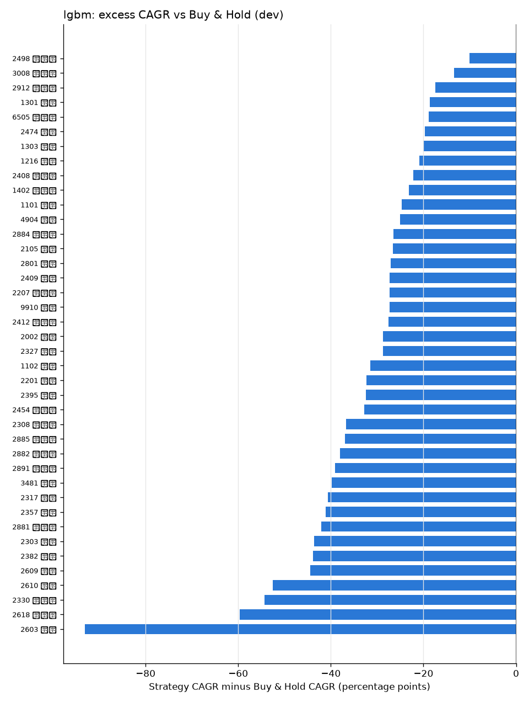

# 多檔研究：lgbm

> 僅供研究與模擬，不構成投資建議；本工具不含任何下單功能。

- 股票池：40 檔（config.yaml `evaluation.universe`），成功 40 檔
- 策略參數：`{'train_size': 500, 'test_size': 60, 'gap': 5, 'threshold': 0.5, 'params': {'n_estimators': 200, 'learning_rate': 0.03, 'num_leaves': 15, 'min_child_samples': 30, 'subsample': 0.8, 'subsample_freq': 1, 'colsample_bytree': 0.8, 'random_state': 42, 'verbose': -1}}`
- 保留期：2025-01-01 起。本報告看不到保留期。
- 買進持有與策略都含股利；訊號用還原價、成交用未還原價；成本、漲跌停、流動性規則同單檔回測
- 顯著性：每檔和 200 組同持股比例 / 換手率的隨機訊號比較
- **存活者偏差**：股票池都是現在仍上市的公司，已下市的股票不在裡面，所有結果都偏樂觀

## 開發期

| 項目 | 結果 |
|---|---|
| 年化報酬贏買進持有 | 0 / 40 檔（符號檢定 p = 1.000） |
| 年化超額報酬中位數 | -28.8%（平均 -32.9%） |
| 顯著勝過隨機訊號（p < 0.05） | 5 / 40 檔（純運氣預期約 2.0 檔） |
| 勝過隨機訊號的平均百分位 | 60%（無選時能力時約 50%） |
| 最大回撤比買進持有小 | 4 / 40 檔 |
| Sharpe 比買進持有高 | 0 / 40 檔 |
| 平均持股比例 / 平均來回次數 | 44% / 214 |

| 股票 | 期間 | 策略年化 | 買進持有年化 | 超額 | 策略 MDD | 買進持有 MDD | Sharpe（策略 / 買持） | 持股比例 | 來回 | 成本 | 隨機百分位 | p 值 |
|---|---|---|---|---|---|---|---|---|---|---|---|---|
| 2498 宏達電 | 2020-04-30 ~ 2024-12-31 | 1.8% | 11.9% | -10.1% | -50.2% | -58.4% | 0.21 / 0.47 | 41% | 200 | 7,010,485 | 98% | 0.020 |
| 3008 大立光 | 2020-05-04 ~ 2024-12-31 | -17.3% | -3.9% | -13.4% | -59.7% | -47.8% | -1.41 / -0.06 | 29% | 157 | 2,407,340 | 42% | 0.577 |
| 2912 統一超 | 2020-04-30 ~ 2024-12-31 | -17.4% | 0.0% | -17.5% | -59.0% | -14.1% | -1.83 / 0.07 | 39% | 208 | 3,981,263 | 96% | 0.040 |
| 1301 台塑 | 2020-04-30 ~ 2024-12-31 | -27.1% | -8.5% | -18.6% | -78.2% | -54.9% | -2.02 / -0.39 | 46% | 205 | 3,337,351 | 64% | 0.368 |
| 6505 台塑化 | 2020-04-30 ~ 2024-12-31 | -31.9% | -13.0% | -18.8% | -82.7% | -61.6% | -2.50 / -0.56 | 44% | 211 | 3,497,316 | 22% | 0.781 |
| 2474 可成 | 2020-04-30 ~ 2024-12-31 | -17.0% | 2.7% | -19.7% | -60.5% | -31.7% | -1.04 / 0.23 | 44% | 217 | 3,763,706 | 87% | 0.134 |
| 1303 南亞 | 2020-04-30 ~ 2024-12-31 | -26.8% | -6.7% | -20.1% | -75.8% | -53.5% | -1.91 / -0.27 | 50% | 218 | 4,167,430 | 60% | 0.403 |
| 1216 統一 | 2020-04-30 ~ 2024-12-31 | -14.1% | 6.8% | -20.9% | -53.9% | -14.5% | -1.22 / 0.51 | 44% | 213 | 4,529,922 | 98% | 0.020 |
| 2408 南亞科 | 2020-04-30 ~ 2024-12-31 | -32.5% | -10.3% | -22.1% | -83.7% | -63.8% | -1.48 / -0.18 | 48% | 205 | 2,866,315 | 19% | 0.811 |
| 1402 遠東新 | 2020-04-30 ~ 2024-12-31 | -13.5% | 9.7% | -23.2% | -49.2% | -16.6% | -0.91 / 0.58 | 45% | 207 | 4,553,244 | 97% | 0.035 |
| 1101 台泥 | 2020-05-04 ~ 2024-12-31 | -22.9% | 1.8% | -24.7% | -70.1% | -29.4% | -1.83 / 0.19 | 46% | 212 | 3,680,595 | 52% | 0.483 |
| 4904 遠傳 | 2020-04-30 ~ 2024-12-31 | -13.9% | 11.2% | -25.1% | -51.9% | -20.2% | -1.32 / 0.85 | 43% | 229 | 4,623,532 | 99% | 0.015 |
| 2884 玉山金 | 2020-04-30 ~ 2024-12-31 | -19.6% | 6.9% | -26.5% | -63.9% | -25.6% | -1.99 / 0.55 | 42% | 214 | 4,019,400 | 74% | 0.259 |
| 2105 正新 | 2020-04-30 ~ 2024-12-31 | -14.7% | 12.0% | -26.6% | -54.5% | -39.3% | -0.83 / 0.59 | 41% | 207 | 4,461,756 | 82% | 0.189 |
| 2801 彰銀 | 2020-04-30 ~ 2024-12-31 | -23.2% | 3.9% | -27.1% | -70.2% | -16.2% | -2.74 / 0.38 | 46% | 229 | 3,834,464 | 66% | 0.338 |
| 2409 友達 | 2020-04-30 ~ 2024-12-31 | -6.6% | 20.7% | -27.3% | -48.6% | -56.4% | -0.10 / 0.67 | 42% | 222 | 6,713,367 | 92% | 0.080 |
| 2207 和泰車 | 2020-05-06 ~ 2024-12-31 | -21.1% | 6.2% | -27.4% | -69.3% | -28.1% | -1.31 / 0.37 | 49% | 217 | 3,604,959 | 42% | 0.587 |
| 9910 豐泰 | 2020-04-30 ~ 2024-12-31 | -24.9% | 2.5% | -27.4% | -75.7% | -35.6% | -1.09 / 0.23 | 51% | 246 | 4,571,146 | 59% | 0.413 |
| 2412 中華電 | 2020-05-04 ~ 2024-12-31 | -21.0% | 6.6% | -27.5% | -65.7% | -14.7% | -3.86 / 0.71 | 27% | 193 | 3,564,667 | 36% | 0.647 |
| 2002 中鋼 | 2020-05-07 ~ 2024-12-31 | -23.9% | 4.9% | -28.8% | -76.5% | -46.0% | -1.36 / 0.32 | 42% | 231 | 4,625,573 | 56% | 0.438 |
| 2327 國巨 | 2020-05-07 ~ 2024-12-31 | -15.5% | 13.2% | -28.8% | -53.8% | -54.2% | -0.53 / 0.52 | 45% | 212 | 4,218,985 | 66% | 0.338 |
| 1102 亞泥 | 2020-04-30 ~ 2024-12-31 | -25.5% | 5.9% | -31.4% | -74.0% | -16.2% | -2.45 / 0.49 | 45% | 212 | 3,211,037 | 9% | 0.910 |
| 2201 裕隆 | 2020-05-04 ~ 2024-12-31 | -1.1% | 31.2% | -32.3% | -52.0% | -39.8% | 0.12 / 0.81 | 46% | 217 | 8,567,406 | 89% | 0.114 |
| 2395 研華 | 2020-04-30 ~ 2024-12-31 | -20.3% | 12.1% | -32.4% | -66.4% | -25.4% | -1.11 / 0.61 | 49% | 226 | 4,350,808 | 50% | 0.502 |
| 2454 聯發科 | 2020-04-30 ~ 2024-12-31 | 3.3% | 36.1% | -32.7% | -51.2% | -45.9% | 0.26 / 1.06 | 44% | 224 | 6,644,222 | 95% | 0.055 |
| 2308 台達電 | 2020-04-30 ~ 2024-12-31 | -7.0% | 29.7% | -36.7% | -60.7% | -30.9% | -0.26 / 1.04 | 46% | 228 | 4,821,492 | 89% | 0.114 |
| 2885 元大金 | 2020-05-04 ~ 2024-12-31 | -14.5% | 22.5% | -37.0% | -58.1% | -23.1% | -0.95 / 1.24 | 52% | 211 | 4,180,408 | 46% | 0.542 |
| 2882 國泰金 | 2020-04-30 ~ 2024-12-31 | -20.9% | 17.2% | -38.0% | -69.4% | -38.3% | -1.60 / 0.90 | 41% | 212 | 4,473,671 | 28% | 0.726 |
| 2891 中信金 | 2020-04-30 ~ 2024-12-31 | -18.6% | 20.4% | -39.0% | -63.6% | -29.9% | -1.30 / 1.10 | 49% | 230 | 4,112,945 | 48% | 0.517 |
| 3481 群創 | 2020-04-30 ~ 2024-12-31 | -16.6% | 23.1% | -39.8% | -71.5% | -62.0% | -0.45 / 0.71 | 45% | 242 | 5,874,910 | 62% | 0.388 |
| 2317 鴻海 | 2020-05-11 ~ 2024-12-31 | -16.6% | 24.0% | -40.6% | -57.8% | -25.0% | -0.94 / 0.99 | 39% | 213 | 4,487,679 | 56% | 0.443 |
| 2357 華碩 | 2020-04-30 ~ 2024-12-31 | -7.8% | 33.3% | -41.1% | -52.3% | -27.2% | -0.31 / 1.29 | 49% | 204 | 4,848,839 | 64% | 0.358 |
| 2881 富邦金 | 2020-04-30 ~ 2024-12-31 | -14.9% | 27.2% | -42.1% | -55.5% | -28.6% | -1.02 / 1.34 | 41% | 197 | 4,481,061 | 32% | 0.687 |
| 2303 聯電 | 2020-05-04 ~ 2024-12-31 | -11.3% | 32.3% | -43.7% | -76.6% | -43.7% | -0.32 / 0.99 | 46% | 212 | 8,710,080 | 58% | 0.418 |
| 2382 廣達 | 2020-04-30 ~ 2024-12-31 | -1.4% | 42.4% | -43.8% | -49.5% | -28.4% | 0.06 / 1.26 | 49% | 218 | 5,268,569 | 84% | 0.169 |
| 2609 陽明 | 2020-04-30 ~ 2024-12-31 | 3.5% | 48.0% | -44.5% | -75.6% | -59.1% | 0.28 / 1.17 | 43% | 214 | 8,859,280 | 56% | 0.443 |
| 2610 華航 | 2020-04-30 ~ 2024-12-31 | -20.3% | 32.2% | -52.6% | -71.6% | -45.1% | -0.80 / 0.89 | 32% | 201 | 4,160,502 | 30% | 0.701 |
| 2330 台積電 | 2020-04-30 ~ 2024-12-31 | -20.9% | 33.3% | -54.3% | -72.7% | -42.3% | -1.26 / 1.22 | 45% | 225 | 4,252,767 | 4% | 0.955 |
| 2618 長榮航 | 2020-04-30 ~ 2024-12-31 | -21.2% | 38.4% | -59.6% | -66.2% | -36.8% | -0.80 / 1.01 | 44% | 209 | 4,180,107 | 8% | 0.915 |
| 2603 長榮 | 2020-04-30 ~ 2024-12-31 | 20.3% | 113.4% | -93.1% | -58.3% | -59.1% | 0.50 / 1.44 | 42% | 198 | 13,207,061 | 68% | 0.328 |
