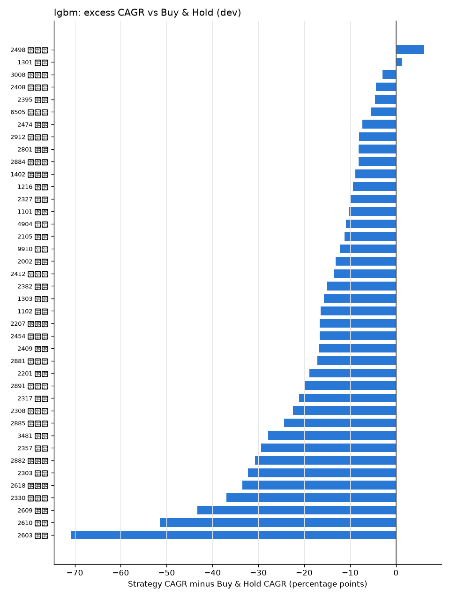

# 多檔研究：lgbm

> 僅供研究與模擬，不構成投資建議；本工具不含任何下單功能。

- 股票池：40 檔（config.yaml `evaluation.universe`），成功 40 檔
- 策略參數：`{'train_size': 500, 'test_size': 60, 'gap': 5, 'threshold': 0.55, 'params': {'n_estimators': 200, 'learning_rate': 0.03, 'num_leaves': 15, 'min_child_samples': 30, 'subsample': 0.8, 'subsample_freq': 1, 'colsample_bytree': 0.8, 'random_state': 42, 'verbose': -1}, 'horizon': 5, 'hurdle': 0.006, 'exit_threshold': 0.45, 'min_hold': 5}`
- 保留期：2025-01-01 起。本報告看不到保留期。
- 買進持有與策略都含股利；訊號用還原價、成交用未還原價；成本、漲跌停、流動性規則同單檔回測
- 顯著性：每檔和 100 組同持股比例 / 換手率的隨機訊號比較
- **存活者偏差**：股票池都是現在仍上市的公司，已下市的股票不在裡面，所有結果都偏樂觀

## 開發期

| 項目 | 結果 |
|---|---|
| 年化報酬贏買進持有 | 2 / 40 檔（符號檢定 p = 1.000） |
| 年化超額報酬中位數 | -15.3%（平均 -18.0%） |
| 顯著勝過隨機訊號（p < 0.05） | 2 / 40 檔（純運氣預期約 2.0 檔） |
| 勝過隨機訊號的平均百分位 | 52%（無選時能力時約 50%） |
| 最大回撤比買進持有小 | 13 / 40 檔 |
| Sharpe 比買進持有高 | 1 / 40 檔 |
| 平均持股比例 / 平均來回次數 | 51% / 74 |

| 股票 | 期間 | 策略年化 | 買進持有年化 | 超額 | 策略 MDD | 買進持有 MDD | Sharpe（策略 / 買持） | 持股比例 | 來回 | 成本 | 隨機百分位 | p 值 |
|---|---|---|---|---|---|---|---|---|---|---|---|---|
| 2498 宏達電 | 2020-04-30 ~ 2024-12-31 | 18.0% | 11.9% | +6.1% | -37.0% | -58.4% | 0.71 / 0.47 | 46% | 65 | 3,049,599 | 99% | 0.020 |
| 1301 台塑 | 2020-04-30 ~ 2024-12-31 | -7.2% | -8.5% | +1.3% | -55.8% | -54.9% | -0.42 / -0.39 | 45% | 61 | 1,802,856 | 91% | 0.099 |
| 3008 大立光 | 2020-05-04 ~ 2024-12-31 | -6.9% | -3.9% | -2.9% | -38.7% | -47.8% | -0.34 / -0.06 | 51% | 70 | 1,237,263 | 48% | 0.525 |
| 2408 南亞科 | 2020-04-30 ~ 2024-12-31 | -14.7% | -10.3% | -4.4% | -59.2% | -63.8% | -0.47 / -0.18 | 58% | 78 | 1,988,650 | 69% | 0.317 |
| 2395 研華 | 2020-04-30 ~ 2024-12-31 | 7.5% | 12.1% | -4.6% | -27.9% | -25.4% | 0.46 / 0.61 | 56% | 81 | 3,032,837 | 99% | 0.020 |
| 6505 台塑化 | 2020-04-30 ~ 2024-12-31 | -18.4% | -13.0% | -5.4% | -60.7% | -61.6% | -1.26 / -0.56 | 50% | 83 | 1,838,603 | 44% | 0.564 |
| 2474 可成 | 2020-04-30 ~ 2024-12-31 | -4.6% | 2.7% | -7.3% | -33.0% | -31.7% | -0.18 / 0.23 | 51% | 74 | 1,713,468 | 75% | 0.257 |
| 2912 統一超 | 2020-04-30 ~ 2024-12-31 | -8.0% | 0.0% | -8.1% | -31.9% | -14.1% | -0.85 / 0.07 | 35% | 64 | 1,528,508 | 45% | 0.554 |
| 2801 彰銀 | 2020-04-30 ~ 2024-12-31 | -4.2% | 3.9% | -8.1% | -23.7% | -16.2% | -0.45 / 0.38 | 41% | 66 | 1,714,182 | 82% | 0.188 |
| 2884 玉山金 | 2020-04-30 ~ 2024-12-31 | -1.3% | 6.9% | -8.2% | -24.3% | -25.6% | -0.06 / 0.55 | 52% | 75 | 2,134,925 | 87% | 0.139 |
| 1402 遠東新 | 2020-04-30 ~ 2024-12-31 | 0.9% | 9.7% | -8.8% | -22.6% | -16.6% | 0.13 / 0.58 | 51% | 71 | 2,143,758 | 88% | 0.129 |
| 1216 統一 | 2020-04-30 ~ 2024-12-31 | -2.6% | 6.8% | -9.4% | -17.7% | -14.5% | -0.20 / 0.51 | 36% | 66 | 1,915,394 | 86% | 0.149 |
| 2327 國巨 | 2020-05-07 ~ 2024-12-31 | 3.4% | 13.2% | -9.9% | -46.6% | -54.2% | 0.26 / 0.52 | 59% | 82 | 2,333,195 | 78% | 0.228 |
| 1101 台泥 | 2020-05-04 ~ 2024-12-31 | -8.5% | 1.8% | -10.2% | -41.7% | -29.4% | -0.61 / 0.19 | 49% | 72 | 1,922,279 | 54% | 0.465 |
| 4904 遠傳 | 2020-04-30 ~ 2024-12-31 | 0.3% | 11.2% | -10.9% | -12.4% | -20.2% | 0.08 / 0.85 | 43% | 70 | 1,952,430 | 92% | 0.089 |
| 2105 正新 | 2020-04-30 ~ 2024-12-31 | 0.8% | 12.0% | -11.2% | -35.7% | -39.3% | 0.14 / 0.59 | 49% | 76 | 2,156,215 | 80% | 0.208 |
| 9910 豐泰 | 2020-04-30 ~ 2024-12-31 | -9.7% | 2.5% | -12.2% | -49.4% | -35.6% | -0.31 / 0.23 | 56% | 78 | 1,875,685 | 40% | 0.604 |
| 2002 中鋼 | 2020-05-07 ~ 2024-12-31 | -8.2% | 4.9% | -13.1% | -54.8% | -46.0% | -0.35 / 0.32 | 45% | 73 | 2,252,427 | 43% | 0.574 |
| 2412 中華電 | 2020-05-04 ~ 2024-12-31 | -7.0% | 6.6% | -13.6% | -28.8% | -14.7% | -1.34 / 0.71 | 23% | 45 | 1,114,616 | 3% | 0.970 |
| 2382 廣達 | 2020-04-30 ~ 2024-12-31 | 27.5% | 42.4% | -14.9% | -29.0% | -28.4% | 0.94 / 1.26 | 65% | 80 | 3,421,872 | 82% | 0.188 |
| 1303 南亞 | 2020-04-30 ~ 2024-12-31 | -22.4% | -6.7% | -15.7% | -70.6% | -53.5% | -1.35 / -0.27 | 59% | 78 | 1,829,816 | 4% | 0.960 |
| 1102 亞泥 | 2020-04-30 ~ 2024-12-31 | -10.5% | 5.9% | -16.4% | -39.7% | -16.2% | -0.92 / 0.49 | 48% | 71 | 1,623,993 | 15% | 0.851 |
| 2207 和泰車 | 2020-05-06 ~ 2024-12-31 | -10.4% | 6.2% | -16.6% | -53.9% | -28.1% | -0.46 / 0.37 | 50% | 77 | 1,808,525 | 19% | 0.812 |
| 2454 聯發科 | 2020-04-30 ~ 2024-12-31 | 19.4% | 36.1% | -16.7% | -30.0% | -45.9% | 0.75 / 1.06 | 59% | 86 | 4,627,422 | 83% | 0.178 |
| 2409 友達 | 2020-04-30 ~ 2024-12-31 | 3.9% | 20.7% | -16.8% | -41.2% | -56.4% | 0.28 / 0.67 | 61% | 81 | 3,467,466 | 61% | 0.396 |
| 2881 富邦金 | 2020-04-30 ~ 2024-12-31 | 10.1% | 27.2% | -17.1% | -33.0% | -28.6% | 0.66 / 1.34 | 52% | 67 | 2,508,819 | 84% | 0.168 |
| 2201 裕隆 | 2020-05-04 ~ 2024-12-31 | 12.4% | 31.2% | -18.8% | -38.7% | -39.8% | 0.47 / 0.81 | 52% | 81 | 3,752,897 | 88% | 0.129 |
| 2891 中信金 | 2020-04-30 ~ 2024-12-31 | 0.3% | 20.4% | -20.1% | -34.2% | -29.9% | 0.10 / 1.10 | 50% | 68 | 1,785,394 | 46% | 0.545 |
| 2317 鴻海 | 2020-05-11 ~ 2024-12-31 | 2.9% | 24.0% | -21.1% | -23.4% | -25.0% | 0.24 / 0.99 | 47% | 69 | 2,035,950 | 52% | 0.485 |
| 2308 台達電 | 2020-04-30 ~ 2024-12-31 | 7.3% | 29.7% | -22.5% | -31.3% | -30.9% | 0.41 / 1.04 | 63% | 90 | 3,076,155 | 50% | 0.505 |
| 2885 元大金 | 2020-05-04 ~ 2024-12-31 | -1.9% | 22.5% | -24.4% | -37.4% | -23.1% | -0.05 / 1.24 | 55% | 73 | 1,949,871 | 17% | 0.832 |
| 3481 群創 | 2020-04-30 ~ 2024-12-31 | -4.7% | 23.1% | -27.9% | -69.3% | -62.0% | 0.03 / 0.71 | 60% | 93 | 2,762,417 | 29% | 0.713 |
| 2357 華碩 | 2020-04-30 ~ 2024-12-31 | 3.9% | 33.3% | -29.4% | -41.8% | -27.2% | 0.28 / 1.29 | 64% | 96 | 3,017,314 | 29% | 0.713 |
| 2882 國泰金 | 2020-04-30 ~ 2024-12-31 | -13.6% | 17.2% | -30.7% | -53.2% | -38.3% | -0.76 / 0.90 | 54% | 73 | 1,584,117 | 0% | 1.000 |
| 2303 聯電 | 2020-05-04 ~ 2024-12-31 | 0.0% | 32.3% | -32.3% | -46.2% | -43.7% | 0.14 / 0.99 | 57% | 69 | 2,668,954 | 22% | 0.782 |
| 2618 長榮航 | 2020-04-30 ~ 2024-12-31 | 5.0% | 38.4% | -33.4% | -31.6% | -36.8% | 0.31 / 1.01 | 57% | 81 | 2,911,643 | 35% | 0.653 |
| 2330 台積電 | 2020-04-30 ~ 2024-12-31 | -3.6% | 33.3% | -37.0% | -53.6% | -42.3% | -0.08 / 1.22 | 54% | 83 | 1,933,518 | 7% | 0.931 |
| 2609 陽明 | 2020-04-30 ~ 2024-12-31 | 4.7% | 48.0% | -43.3% | -72.3% | -59.1% | 0.31 / 1.17 | 46% | 66 | 2,533,626 | 11% | 0.891 |
| 2610 華航 | 2020-04-30 ~ 2024-12-31 | -19.3% | 32.2% | -51.5% | -73.7% | -45.1% | -0.53 / 0.89 | 47% | 65 | 1,400,505 | 0% | 1.000 |
| 2603 長榮 | 2020-04-30 ~ 2024-12-31 | 42.7% | 113.4% | -70.7% | -65.9% | -59.1% | 0.74 / 1.44 | 54% | 65 | 6,161,192 | 48% | 0.525 |
