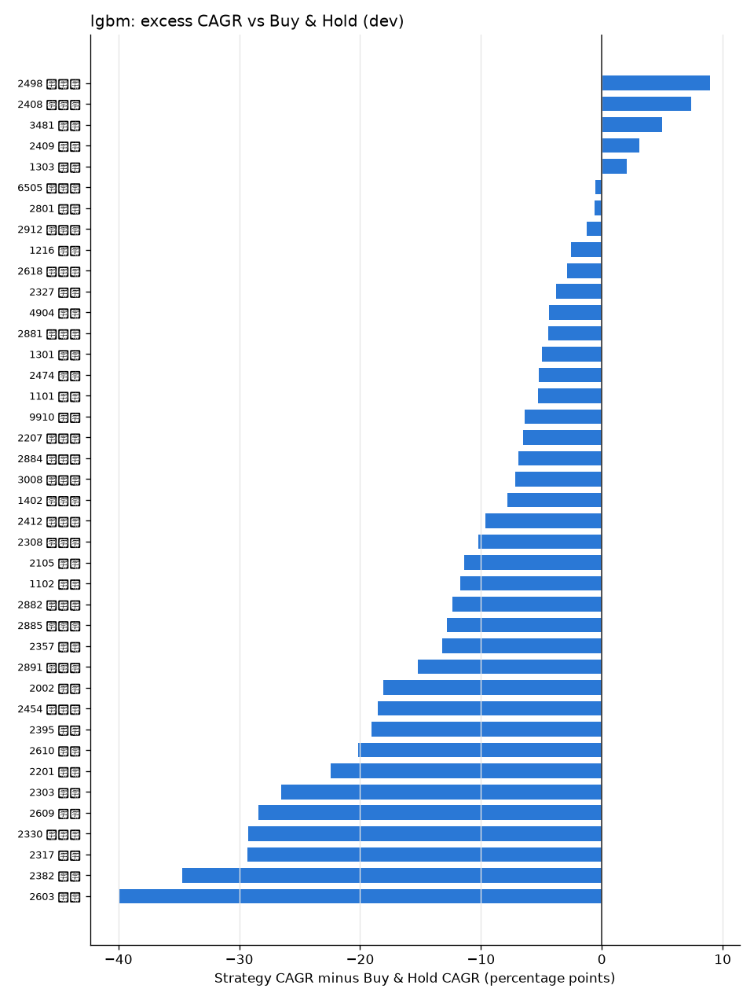

# 多檔研究：lgbm

> 僅供研究與模擬，不構成投資建議；本工具不含任何下單功能。

- 股票池：40 檔（config.yaml `evaluation.universe`），成功 40 檔
- 策略參數：`{'train_size': 500, 'test_size': 60, 'horizon': 20, 'hurdle': 0.02, 'gap': 20, 'threshold': 0.55, 'exit_threshold': 0.45, 'min_hold': 10, 'params': {'n_estimators': 200, 'learning_rate': 0.03, 'num_leaves': 15, 'min_child_samples': 30, 'subsample': 0.8, 'subsample_freq': 1, 'colsample_bytree': 0.8, 'random_state': 42, 'verbose': -1}}`
- 保留期：2025-01-01 起。本報告看不到保留期。
- 買進持有與策略都含股利；訊號用還原價、成交用未還原價；成本、漲跌停、流動性規則同單檔回測
- 顯著性：每檔和 100 組同持股比例 / 換手率的隨機訊號比較
- **存活者偏差**：股票池都是現在仍上市的公司，已下市的股票不在裡面，所有結果都偏樂觀

## 開發期

| 項目 | 結果 |
|---|---|
| 年化報酬贏買進持有 | 5 / 40 檔（符號檢定 p = 1.000） |
| 年化超額報酬中位數 | -7.5%（平均 -10.7%） |
| 顯著勝過隨機訊號（p < 0.05） | 6 / 40 檔（純運氣預期約 2.0 檔） |
| 勝過隨機訊號的平均百分位 | 55%（無選時能力時約 50%） |
| 最大回撤比買進持有小 | 18 / 40 檔 |
| Sharpe 比買進持有高 | 7 / 40 檔 |
| 平均持股比例 / 平均來回次數 | 53% / 41 |

| 股票 | 期間 | 策略年化 | 買進持有年化 | 超額 | 策略 MDD | 買進持有 MDD | Sharpe（策略 / 買持） | 持股比例 | 來回 | 成本 | 隨機百分位 | p 值 |
|---|---|---|---|---|---|---|---|---|---|---|---|---|
| 2498 宏達電 | 2020-05-22 ~ 2024-12-31 | 21.8% | 12.8% | +9.0% | -33.1% | -58.4% | 0.82 / 0.49 | 45% | 40 | 2,452,545 | 96% | 0.050 |
| 2408 南亞科 | 2020-05-22 ~ 2024-12-31 | -2.1% | -9.5% | +7.4% | -49.5% | -63.6% | 0.05 / -0.15 | 59% | 52 | 2,064,277 | 94% | 0.069 |
| 3481 群創 | 2020-05-22 ~ 2024-12-31 | 27.4% | 22.5% | +5.0% | -46.7% | -62.0% | 0.85 / 0.70 | 70% | 56 | 3,537,658 | 99% | 0.020 |
| 2409 友達 | 2020-05-22 ~ 2024-12-31 | 22.1% | 19.0% | +3.1% | -39.6% | -56.4% | 0.77 / 0.63 | 60% | 41 | 3,159,260 | 94% | 0.069 |
| 1303 南亞 | 2020-05-22 ~ 2024-12-31 | -4.8% | -6.9% | +2.1% | -41.0% | -53.3% | -0.21 / -0.29 | 58% | 46 | 1,610,709 | 87% | 0.139 |
| 6505 台塑化 | 2020-05-22 ~ 2024-12-31 | -14.7% | -14.2% | -0.5% | -52.4% | -61.6% | -1.07 / -0.63 | 38% | 38 | 842,501 | 32% | 0.683 |
| 2801 彰銀 | 2020-05-22 ~ 2024-12-31 | 3.3% | 3.9% | -0.6% | -10.4% | -16.2% | 0.42 / 0.38 | 43% | 41 | 1,258,568 | 99% | 0.020 |
| 2912 統一超 | 2020-05-22 ~ 2024-12-31 | -0.7% | 0.5% | -1.2% | -11.7% | -12.5% | -0.06 / 0.11 | 27% | 24 | 692,406 | 79% | 0.218 |
| 1216 統一 | 2020-05-22 ~ 2024-12-31 | 3.7% | 6.3% | -2.5% | -10.9% | -14.6% | 0.42 / 0.49 | 31% | 26 | 792,242 | 97% | 0.040 |
| 2618 長榮航 | 2020-05-22 ~ 2024-12-31 | 35.8% | 38.7% | -2.9% | -41.8% | -36.8% | 1.09 / 1.02 | 65% | 38 | 3,216,947 | 93% | 0.079 |
| 2327 國巨 | 2020-05-28 ~ 2024-12-31 | 7.0% | 10.8% | -3.8% | -51.5% | -52.9% | 0.38 / 0.48 | 58% | 43 | 1,591,766 | 86% | 0.149 |
| 4904 遠傳 | 2020-05-22 ~ 2024-12-31 | 6.9% | 11.3% | -4.4% | -7.8% | -20.3% | 0.76 / 0.86 | 34% | 33 | 1,088,020 | 99% | 0.020 |
| 2881 富邦金 | 2020-05-22 ~ 2024-12-31 | 22.4% | 26.9% | -4.4% | -30.5% | -28.6% | 1.23 / 1.32 | 56% | 39 | 1,940,688 | 99% | 0.020 |
| 1301 台塑 | 2020-05-22 ~ 2024-12-31 | -13.9% | -8.9% | -4.9% | -52.8% | -54.9% | -0.88 / -0.42 | 48% | 41 | 954,784 | 34% | 0.663 |
| 2474 可成 | 2020-05-22 ~ 2024-12-31 | -0.4% | 4.8% | -5.2% | -25.6% | -29.9% | 0.06 / 0.33 | 46% | 38 | 1,089,103 | 69% | 0.317 |
| 1101 台泥 | 2020-05-25 ~ 2024-12-31 | -3.8% | 1.4% | -5.3% | -32.5% | -29.4% | -0.23 / 0.17 | 57% | 45 | 1,316,169 | 65% | 0.356 |
| 9910 豐泰 | 2020-05-22 ~ 2024-12-31 | -4.1% | 2.2% | -6.4% | -46.8% | -30.1% | -0.05 / 0.21 | 58% | 47 | 1,185,192 | 48% | 0.525 |
| 2207 和泰車 | 2020-05-27 ~ 2024-12-31 | -0.6% | 5.9% | -6.5% | -44.8% | -29.0% | 0.06 / 0.35 | 45% | 38 | 1,063,872 | 58% | 0.426 |
| 2884 玉山金 | 2020-05-22 ~ 2024-12-31 | 1.0% | 7.9% | -6.9% | -22.1% | -25.6% | 0.14 / 0.64 | 61% | 49 | 1,533,336 | 69% | 0.317 |
| 3008 大立光 | 2020-05-25 ~ 2024-12-31 | -10.9% | -3.7% | -7.2% | -52.9% | -47.4% | -0.57 / -0.06 | 52% | 41 | 638,200 | 16% | 0.842 |
| 1402 遠東新 | 2020-05-22 ~ 2024-12-31 | 0.4% | 8.2% | -7.8% | -18.3% | -16.6% | 0.11 / 0.52 | 56% | 46 | 1,340,945 | 71% | 0.297 |
| 2412 中華電 | 2020-05-25 ~ 2024-12-31 | -3.4% | 6.2% | -9.6% | -17.2% | -14.6% | -0.75 / 0.68 | 16% | 18 | 475,090 | 11% | 0.891 |
| 2308 台達電 | 2020-05-22 ~ 2024-12-31 | 20.8% | 31.0% | -10.2% | -24.3% | -30.9% | 0.88 / 1.08 | 67% | 52 | 2,418,992 | 92% | 0.089 |
| 2105 正新 | 2020-05-22 ~ 2024-12-31 | 1.3% | 12.7% | -11.4% | -38.7% | -39.3% | 0.16 / 0.61 | 55% | 47 | 1,603,722 | 46% | 0.545 |
| 1102 亞泥 | 2020-05-22 ~ 2024-12-31 | -6.8% | 5.0% | -11.7% | -34.7% | -16.2% | -0.47 / 0.42 | 61% | 52 | 1,384,038 | 14% | 0.861 |
| 2882 國泰金 | 2020-05-22 ~ 2024-12-31 | 4.9% | 17.2% | -12.4% | -39.9% | -38.3% | 0.36 / 0.90 | 63% | 32 | 1,007,482 | 25% | 0.752 |
| 2885 元大金 | 2020-05-25 ~ 2024-12-31 | 10.3% | 23.2% | -12.8% | -22.9% | -23.1% | 0.73 / 1.28 | 56% | 46 | 1,721,469 | 72% | 0.287 |
| 2357 華碩 | 2020-05-22 ~ 2024-12-31 | 19.3% | 32.6% | -13.2% | -33.7% | -27.3% | 0.85 / 1.26 | 63% | 49 | 1,818,941 | 70% | 0.307 |
| 2891 中信金 | 2020-05-22 ~ 2024-12-31 | 5.4% | 20.6% | -15.2% | -37.7% | -29.9% | 0.41 / 1.11 | 60% | 43 | 1,298,372 | 27% | 0.733 |
| 2002 中鋼 | 2020-05-28 ~ 2024-12-31 | -13.0% | 5.1% | -18.1% | -63.1% | -45.2% | -0.61 / 0.32 | 43% | 34 | 786,005 | 0% | 1.000 |
| 2454 聯發科 | 2020-05-22 ~ 2024-12-31 | 15.3% | 33.8% | -18.5% | -50.9% | -46.3% | 0.62 / 1.01 | 70% | 46 | 1,742,407 | 34% | 0.663 |
| 2395 研華 | 2020-05-22 ~ 2024-12-31 | -7.9% | 11.2% | -19.0% | -43.9% | -25.1% | -0.27 / 0.58 | 60% | 43 | 1,149,189 | 4% | 0.960 |
| 2610 華航 | 2020-05-22 ~ 2024-12-31 | 10.9% | 31.1% | -20.2% | -45.9% | -45.1% | 0.47 / 0.87 | 60% | 40 | 1,705,057 | 56% | 0.446 |
| 2201 裕隆 | 2020-05-25 ~ 2024-12-31 | -8.6% | 13.9% | -22.4% | -43.0% | -39.8% | -0.24 / 0.55 | 58% | 42 | 1,081,090 | 6% | 0.941 |
| 2303 聯電 | 2020-05-25 ~ 2024-12-31 | 7.0% | 33.5% | -26.5% | -48.4% | -43.7% | 0.38 / 1.01 | 58% | 39 | 2,009,743 | 23% | 0.772 |
| 2609 陽明 | 2020-05-22 ~ 2024-12-31 | 20.7% | 49.2% | -28.4% | -68.6% | -59.2% | 0.64 / 1.18 | 53% | 33 | 2,666,252 | 34% | 0.663 |
| 2330 台積電 | 2020-05-22 ~ 2024-12-31 | 6.0% | 35.3% | -29.3% | -41.2% | -43.1% | 0.38 / 1.25 | 60% | 41 | 1,573,398 | 18% | 0.822 |
| 2317 鴻海 | 2020-06-01 ~ 2024-12-31 | -4.2% | 25.2% | -29.3% | -36.7% | -25.1% | -0.14 / 1.02 | 45% | 41 | 1,215,293 | 9% | 0.911 |
| 2382 廣達 | 2020-05-22 ~ 2024-12-31 | 5.5% | 40.2% | -34.7% | -35.0% | -28.3% | 0.33 / 1.21 | 67% | 52 | 1,695,204 | 3% | 0.970 |
| 2603 長榮 | 2020-05-22 ~ 2024-12-31 | 41.6% | 81.5% | -39.9% | -65.1% | -64.8% | 1.01 / 1.42 | 57% | 39 | 4,765,523 | 53% | 0.475 |
