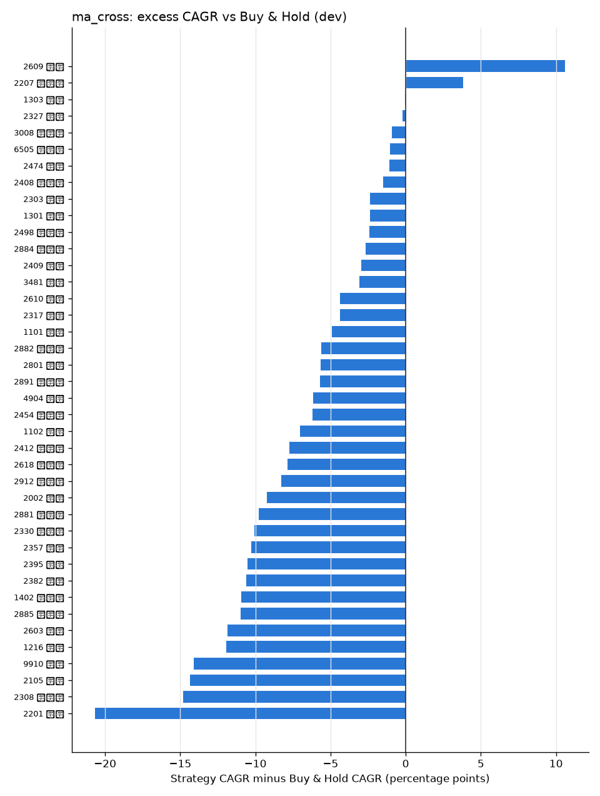

# 多檔研究：ma_cross

> 僅供研究與模擬，不構成投資建議；本工具不含任何下單功能。

- 股票池：40 檔（config.yaml `evaluation.universe`），成功 40 檔
- 策略參數：`{'fast': 5, 'slow': 20}`
- 保留期：2025-01-01 起。本報告看不到保留期。
- 買進持有與策略都含股利；訊號用還原價、成交用未還原價；成本、漲跌停、流動性規則同單檔回測
- 顯著性：每檔和 200 組同持股比例 / 換手率的隨機訊號比較
- **存活者偏差**：股票池都是現在仍上市的公司，已下市的股票不在裡面，所有結果都偏樂觀

## 開發期

| 項目 | 結果 |
|---|---|
| 年化報酬贏買進持有 | 2 / 40 檔（符號檢定 p = 1.000） |
| 年化超額報酬中位數 | -5.9%（平均 -6.3%） |
| 顯著勝過隨機訊號（p < 0.05） | 2 / 40 檔（純運氣預期約 2.0 檔） |
| 勝過隨機訊號的平均百分位 | 56%（無選時能力時約 50%） |
| 最大回撤比買進持有小 | 20 / 40 檔 |
| Sharpe 比買進持有高 | 5 / 40 檔 |
| 平均持股比例 / 平均來回次數 | 54% / 54 |

| 股票 | 期間 | 策略年化 | 買進持有年化 | 超額 | 策略 MDD | 買進持有 MDD | Sharpe（策略 / 買持） | 持股比例 | 來回 | 成本 | 隨機百分位 | p 值 |
|---|---|---|---|---|---|---|---|---|---|---|---|---|
| 2609 陽明 | 2018-01-29 ~ 2024-12-31 | 51.8% | 41.2% | +10.6% | -44.2% | -63.5% | 1.33 / 0.97 | 50% | 56 | 10,798,468 | 100% | 0.010 |
| 2207 和泰車 | 2018-01-29 ~ 2024-12-31 | 11.1% | 7.3% | +3.8% | -28.7% | -41.1% | 0.65 / 0.43 | 52% | 48 | 2,177,677 | 94% | 0.065 |
| 1303 南亞 | 2018-01-29 ~ 2024-12-31 | -5.5% | -5.5% | -0.0% | -37.3% | -48.3% | -0.36 / -0.24 | 51% | 57 | 1,505,002 | 84% | 0.169 |
| 2327 國巨 | 2018-01-29 ~ 2024-12-31 | 15.0% | 15.2% | -0.2% | -52.9% | -63.8% | 0.59 / 0.58 | 53% | 53 | 3,748,357 | 84% | 0.169 |
| 3008 大立光 | 2018-01-29 ~ 2024-12-31 | -3.4% | -2.4% | -0.9% | -43.6% | -53.4% | -0.07 / 0.06 | 42% | 50 | 886,389 | 55% | 0.458 |
| 6505 台塑化 | 2018-01-29 ~ 2024-12-31 | -12.1% | -11.1% | -1.0% | -58.4% | -62.8% | -0.67 / -0.45 | 44% | 52 | 1,000,789 | 39% | 0.612 |
| 2474 可成 | 2018-01-29 ~ 2024-12-31 | -3.7% | -2.6% | -1.1% | -49.2% | -50.7% | -0.10 / 0.02 | 53% | 54 | 1,112,607 | 60% | 0.408 |
| 2408 南亞科 | 2018-01-29 ~ 2024-12-31 | -8.4% | -6.9% | -1.5% | -53.8% | -57.7% | -0.22 / -0.06 | 48% | 57 | 1,370,412 | 56% | 0.443 |
| 2303 聯電 | 2018-01-29 ~ 2024-12-31 | 20.1% | 22.4% | -2.4% | -25.3% | -42.9% | 0.84 / 0.80 | 56% | 53 | 3,855,506 | 96% | 0.050 |
| 1301 台塑 | 2018-01-29 ~ 2024-12-31 | -8.7% | -6.3% | -2.4% | -45.7% | -50.7% | -0.59 / -0.27 | 49% | 55 | 1,275,766 | 56% | 0.438 |
| 2498 宏達電 | 2018-01-29 ~ 2024-12-31 | -7.5% | -5.1% | -2.4% | -65.5% | -61.0% | -0.10 / 0.09 | 46% | 52 | 1,292,455 | 52% | 0.478 |
| 2884 玉山金 | 2018-01-29 ~ 2024-12-31 | 8.8% | 11.5% | -2.7% | -19.3% | -29.0% | 0.77 / 0.84 | 63% | 43 | 2,117,678 | 84% | 0.159 |
| 2409 友達 | 2018-01-29 ~ 2024-12-31 | 2.0% | 5.0% | -2.9% | -54.5% | -53.1% | 0.21 / 0.31 | 52% | 50 | 1,768,774 | 64% | 0.368 |
| 3481 群創 | 2018-01-29 ~ 2024-12-31 | -0.6% | 2.5% | -3.1% | -56.5% | -60.4% | 0.12 / 0.25 | 50% | 53 | 1,491,458 | 57% | 0.428 |
| 2610 華航 | 2018-01-29 ~ 2024-12-31 | 9.0% | 13.4% | -4.4% | -59.0% | -51.5% | 0.46 / 0.53 | 47% | 53 | 2,069,663 | 86% | 0.149 |
| 2317 鴻海 | 2018-01-29 ~ 2024-12-31 | 8.7% | 13.1% | -4.4% | -33.3% | -26.9% | 0.52 / 0.62 | 52% | 47 | 1,482,480 | 84% | 0.169 |
| 1101 台泥 | 2018-01-29 ~ 2024-12-31 | 1.4% | 6.3% | -4.9% | -24.4% | -24.7% | 0.17 / 0.47 | 56% | 53 | 1,607,249 | 72% | 0.279 |
| 2882 國泰金 | 2018-01-29 ~ 2024-12-31 | 0.9% | 6.5% | -5.6% | -38.4% | -36.0% | 0.13 / 0.44 | 55% | 55 | 1,328,463 | 60% | 0.398 |
| 2801 彰銀 | 2018-01-29 ~ 2024-12-31 | -0.3% | 5.4% | -5.7% | -24.0% | -25.6% | 0.02 / 0.48 | 57% | 54 | 1,614,482 | 64% | 0.368 |
| 2891 中信金 | 2018-01-29 ~ 2024-12-31 | 7.0% | 12.7% | -5.7% | -18.0% | -28.5% | 0.54 / 0.77 | 61% | 45 | 1,330,461 | 64% | 0.368 |
| 4904 遠傳 | 2018-01-29 ~ 2024-12-31 | -0.1% | 6.1% | -6.2% | -20.4% | -19.0% | 0.05 / 0.53 | 58% | 54 | 1,486,530 | 56% | 0.443 |
| 2454 聯發科 | 2018-01-29 ~ 2024-12-31 | 22.5% | 28.7% | -6.2% | -39.7% | -45.4% | 0.87 / 0.91 | 60% | 49 | 2,619,666 | 88% | 0.124 |
| 1102 亞泥 | 2018-01-29 ~ 2024-12-31 | 3.4% | 10.4% | -7.1% | -26.4% | -29.7% | 0.30 / 0.64 | 61% | 50 | 1,771,184 | 60% | 0.408 |
| 2412 中華電 | 2018-01-29 ~ 2024-12-31 | -2.4% | 5.3% | -7.8% | -17.1% | -13.8% | -0.27 / 0.60 | 60% | 64 | 1,708,375 | 37% | 0.632 |
| 2618 長榮航 | 2018-01-29 ~ 2024-12-31 | 11.2% | 19.1% | -7.9% | -46.2% | -43.8% | 0.53 / 0.70 | 55% | 49 | 2,089,938 | 69% | 0.313 |
| 2912 統一超 | 2018-01-29 ~ 2024-12-31 | -6.3% | 2.0% | -8.3% | -49.6% | -23.6% | -0.44 / 0.20 | 48% | 60 | 1,318,449 | 24% | 0.756 |
| 2002 中鋼 | 2018-01-29 ~ 2024-12-31 | -8.5% | 0.8% | -9.2% | -62.9% | -44.1% | -0.43 / 0.14 | 49% | 63 | 1,516,372 | 20% | 0.801 |
| 2881 富邦金 | 2018-01-29 ~ 2024-12-31 | 3.6% | 13.4% | -9.8% | -36.9% | -28.4% | 0.30 / 0.79 | 58% | 58 | 1,549,020 | 44% | 0.562 |
| 2330 台積電 | 2018-01-29 ~ 2024-12-31 | 14.8% | 24.8% | -10.1% | -26.9% | -41.6% | 0.80 / 1.00 | 59% | 54 | 2,357,058 | 80% | 0.199 |
| 2357 華碩 | 2018-01-29 ~ 2024-12-31 | 5.3% | 15.6% | -10.3% | -32.2% | -28.3% | 0.35 / 0.77 | 58% | 56 | 1,604,852 | 47% | 0.532 |
| 2395 研華 | 2018-01-29 ~ 2024-12-31 | 0.4% | 11.0% | -10.5% | -39.5% | -26.5% | 0.12 / 0.57 | 60% | 56 | 1,843,813 | 36% | 0.647 |
| 2382 廣達 | 2018-01-29 ~ 2024-12-31 | 16.6% | 27.2% | -10.6% | -31.6% | -27.7% | 0.75 / 1.01 | 62% | 54 | 1,983,173 | 64% | 0.358 |
| 1402 遠東新 | 2018-01-29 ~ 2024-12-31 | -4.0% | 7.0% | -10.9% | -44.3% | -39.0% | -0.15 / 0.44 | 58% | 58 | 1,833,088 | 21% | 0.791 |
| 2885 元大金 | 2018-01-29 ~ 2024-12-31 | 7.0% | 18.0% | -11.0% | -26.5% | -30.0% | 0.53 / 1.00 | 64% | 52 | 1,903,107 | 38% | 0.617 |
| 2603 長榮 | 2018-01-29 ~ 2024-12-31 | 43.3% | 55.1% | -11.9% | -39.3% | -58.8% | 1.13 / 1.04 | 58% | 46 | 7,378,043 | 84% | 0.164 |
| 1216 統一 | 2018-01-29 ~ 2024-12-31 | -6.3% | 5.6% | -11.9% | -39.6% | -20.9% | -0.44 / 0.42 | 55% | 67 | 1,578,576 | 7% | 0.930 |
| 9910 豐泰 | 2018-01-29 ~ 2024-12-31 | -8.5% | 5.6% | -14.1% | -59.0% | -40.3% | -0.26 / 0.34 | 50% | 55 | 1,531,244 | 14% | 0.861 |
| 2105 正新 | 2018-01-29 ~ 2024-12-31 | -12.4% | 1.9% | -14.3% | -58.9% | -37.3% | -0.64 / 0.20 | 51% | 59 | 1,056,458 | 2% | 0.980 |
| 2308 台達電 | 2018-01-29 ~ 2024-12-31 | 4.3% | 19.1% | -14.8% | -33.4% | -30.0% | 0.30 / 0.77 | 56% | 52 | 1,698,081 | 38% | 0.627 |
| 2201 裕隆 | 2018-01-29 ~ 2024-12-31 | -9.0% | 11.6% | -20.7% | -48.6% | -36.2% | -0.30 / 0.50 | 48% | 61 | 1,223,475 | 7% | 0.930 |
